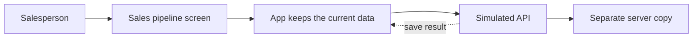

# FurniCraft Sales Pipeline

### HighLevel R1 engineering assignment · Interview brief

## What I built

- A sales workspace for **FurniCraft**, a fictional business that sells office furniture to other companies.
- The app contains 50,000 sample sales opportunities for chairs, desks, conference tables, cabinets, and reception desks.
- Each opportunity shows the customer, product, number of units, deal value in rupees, sales owner, and current stage.
- Example: **Indigo Networks** is considering **115 office chairs** worth **₹1,22,000**. **Aisha Khan** owns the opportunity, which is at **New Lead**.
- Salespeople can find and sort deals, change stages, update many deals together, and retry a save that failed.

I built this to show how a sales team can work with a large list and still understand what is happening when a save is slow or fails.

## How it works

- The screen is built with Vue and TypeScript. Pinia keeps data that is shared across the screen.
- The table only displays rows near the user's scroll position. This avoids putting all 50,000 rows on screen at once.
- The simulated API adds delays and failures. It also keeps a separate copy of the data so the app can demonstrate a teammate changing a deal.

## Key user experience decisions

- **Combine the useful parts of a table and Kanban.** The table makes it easy to compare customer, product, value, owner, and stage. Click a stage at the top to show the deals in that stage, like opening a Kanban column. Move a deal to the previous or next stage with the row arrows or keyboard shortcuts. Use the dropdown to choose any stage directly.
- **Keep the main work in one place.** Summary numbers, filters, and the table stay together, so salespeople do not have to switch pages while reviewing deals.
- **Help the salesperson keep their place.** For example, imagine someone is reviewing deals 1 through 5 and changes deal 5. The updated deal may move to the top of the table. The app briefly highlights it and moves focus to deal 6, so the salesperson can continue where they left off.
- **Let the user choose when to see teammate changes.** A teammate's simulated change waits until the user clicks **Sync updates**. The user can then click **Go to active row** to return to the deal they were working on.
- **Make selection clear for large lists.** The checkbox at the top selects the rows currently shown in the table. **Select all matching** selects every deal that matches the current filters, including deals farther down the list. For example, filter to Proposal Sent, then select all matching to select every deal in that stage.

## When saves fail or teammates change a deal

- **Single deal — optimistic update:** The screen shows the new stage right away, before the save finishes. We use this so salespeople can keep working instead of waiting for a slow response. If the save succeeds, the new stage stays. If it fails, the app shows an error, restores the latest available data, and offers a retry.
- **Two people change the same deal:** Every deal has a version number. If one person saves first, the version increases. A second save based on the older version is rejected, so it cannot silently overwrite the first change. The row then shows **Update conflict** and displays the latest stage from the server. The user can click **Retry**; the app fetches the latest version and tries the user's original stage change again. This retry is automatic: there is no separate screen to compare both changes or choose a different value, so that is an area to improve.
- **Many deals at once:** Bulk updates are sent in batches of up to 500. Some deals can succeed while others fail. Successful changes stay saved; the user can retry only the failed deals. If the user cancels, the current batch finishes before the app stops sending more.
- **Current limitation:** The simulated API does not connect separate browsers or devices. Undo only puts a deal back if nobody has changed it since the bulk update. If the Undo save fails, the deal stays changed and the app does not offer another Undo retry; the user would have to change it back manually.

## What I would improve with more time

1. **Create pipelines:** Let managers create different sales pipelines and choose the stages in each one. A new furniture enquiry and a repeat customer order might follow different steps.
2. **Create opportunities:** Add a form for entering a new deal, including the customer, product, quantity, estimated value, owner, stage, expected close date, and next action.
3. **Add custom fields and more deal details:** Let managers add fields such as delivery city, installation required, or number of office locations. Show contact details, notes, and a history of calls and emails on each deal.
4. **Improve filtering:** Let users filter by product, quantity, close date, delivery city, stage, owner, recent activity, and tags. Let them save useful searches, such as “large chair orders with no recent follow-up.”
5. **Add smart tags:** Automatically label deals using clear rules. For example, tag a deal **High value** if it is above a chosen amount, **Needs follow-up** if there has been no activity for 30 days, **Closing soon** if its expected close date is near, or **Large chair order** if it meets a product and quantity rule. Show why each tag was added and let users correct it.

These additions would help FurniCraft set up its sales process, capture the details needed to fulfill an order, and spot deals that need attention.
