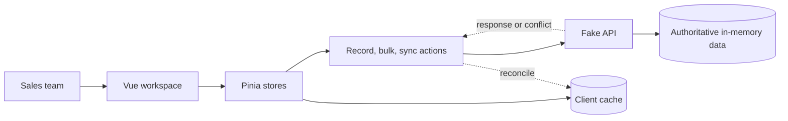

# FurniCraft Sales Pipeline
### HighLevel R1 engineering assignment · Interview brief

## What I built and why

- A frontend CRM workspace for **FurniCraft**, a fictional B2B office furniture supplier using HighLevel.
- A seeded dataset of **50,000 opportunities** for bulk orders of chairs, desks, conference tables, storage cabinets, and reception desks.
- Each opportunity shows the prospective customer, product and quantity, INR deal value, owner, stage, and activity dates.
- Example: **Indigo Networks · Office chairs · 115 units · ₹1,22,000 · Aisha Khan · New Lead**.
- Users can search, filter, sort, update stages, select records for bulk changes, retry failed records, and attempt a version-checked undo.

The goal is to make a large pipeline practical to review while showing clear save status and recovery when requests fail.

## Architecture at a glance

- **Vue 3 + TypeScript** build the typed, component-based interface; **Pinia** holds shared client state.
- **TanStack Vue Virtual** renders viewport rows plus eight overscan rows, not all 50,000 DOM rows.
- The fake API has a separate server copy and simulates latency, failures, offline mode, and version checks.

## Key UX decisions

- **Table-first, with stage arrows and dropdown.** A table makes customer, product, value, owner, stage, and activity easy to compare and supports bulk selection. Kanban is more visual, but large columns are less effective for dense scanning. The stage strip gives a compact pipeline overview.
- **One focused workspace.** Metrics, filters, table, and bulk actions stay together so reps keep their context. Separate pages could fit a larger CRM, but add navigation and state coordination for this assignment.
- **Preserve review position.** After a successful save, the moved row gets a brief highlight and focus advances to the next opportunity in the old order. Teammate updates wait for explicit sync; **Go to active row** helps restore the user's place.
- **Selection follows IDs.** It survives virtual rows mounting and unmounting. The header checkbox selects rendered rows; **Select all matching** snapshots the filtered IDs.

## Failed saves and teammate changes

- **Individual save:** The stage changes optimistically, then the API response either confirms it or triggers reconciliation. Errors and conflicts have distinct states and retry actions.
- **Same-record ordering:** Writes are serialized locally; revisions prevent an older response from replacing newer user intent.
- **Version conflict:** A write includes its expected version. If User A changes version 1 to 2, User B's write expecting version 1 is rejected with the latest record instead of overwriting A.
- **Bulk save:** Records are sent in sequential batches of up to 500, with per-record outcomes. Successful rows remain saved; failed rows can be retried alone. Cancel stops before the next batch; an in-flight batch finishes first.
- **Important boundary:** Teammate edits are simulated in one in-memory API, not synchronized across real browsers or devices. Undo is a version-checked compensating update, not a database transaction, and its failure recovery needs improvement.

## What I would do with more time

1. **Correctness and tests:** generate the required 20 owners (the current generator has 7); add deterministic tests for mixed bulk outcomes, failed undo, and teammate conflicts; fix the owner-only stage count's accessible label.
2. **Production data flow:** move search, filtering, sorting, metrics, and pagination to the server; replace full-snapshot sync with incremental updates.
3. **Production safeguards:** add authentication/authorization, runtime validation, idempotency keys, durable bulk-job results, explicit cancellation semantics, and observability.
4. **Measure performance:** profile the 50,000-record workflow in a production build before making numeric performance claims. No browser benchmark exists today.

**Trade-off:** This frontend simulation demonstrates reliability patterns, but real production guarantees require a backend that enforces versions atomically and shares authoritative state across clients.
