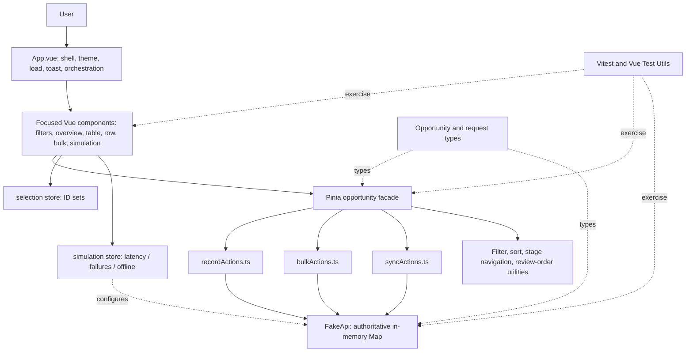
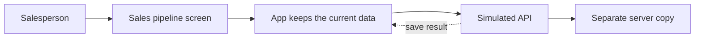

1. DESIGN DECISIONS

# Design decisions and trade-offs

This document explains the choices visible in the current FurniCraft Sales Pipeline implementation. The application is an interview assignment prototype: its fake API is an in-memory model, not a production backend. File paths below are relative to the repository root.

## Product and interface

### 1. Table-first workspace instead of Kanban

- **Decision / problem:** Use one searchable, sortable, filterable virtual table as the main work surface. The assignment has 50,000 opportunities; a Kanban board would create seven large stage columns and make cross-stage search, comparison, bulk selection, and keyboard review awkward.
- **Why / benefits:** Salespeople can scan company, product, quantity, value, owner, stage, activity, and save state together. Stage arrows provide quick adjacent moves while a dropdown still supports direct stage selection. The stage strip above the table provides a lightweight pipeline overview and can filter the table.
- **Alternatives:** A full Kanban board; a separate board and table mode; a paged table. A board can make stage movement intuitive but does not solve large-list scanning. Two modes add navigation and duplicate interaction rules. Pagination limits DOM work but interrupts continuous review and requires page-aware bulk selection.
- **Trade-offs / production change:** The table is dense and less spatial than Kanban; one row has many controls. A production product should validate task workflows with sales users and may offer a saved Kanban view backed by server queries. Current implementation: `src/components/OpportunityTable.vue`, `OpportunityTableRow.vue`, `PipelineOverview.vue`, `utils/stageNavigation.ts`.

### 2. Explicit stage controls rather than drag-and-drop

- **Decision:** Inline stage select plus previous/next arrows. Arrows follow a quick progression that omits terminal Won/Lost from the linear route; direct dropdown can choose any stage.
- **Reason / benefits:** Controls are visible, keyboard operable, and precise in a dense table. The arrow flow avoids drag precision and makes the action explicit. After a save, focus moves to the next record in the review order captured before resorting; a briefly green border indicates the moved row.
- **Alternatives:** Drag-and-drop, only a dropdown, or keyboard shortcuts only. Drag/drop is harder to use with a virtualized table and keyboard; dropdown-only costs more interaction; keyboard-only is undiscoverable.
- **Trade-offs:** More controls in the row and arrows require users to learn their meaning. `stageNavigation.ts`, `OpportunityTableRow.vue`, and `OpportunityTable.vue` implement this. The default sort is updatedAt descending, so saved rows can move.

### 3. Visible synchronization state

- **Decision:** Simulated teammate edits change fake server state and mark pending IDs; user explicitly clicks **Sync updates** to fetch the latest full snapshot. The active row remains highlighted and a **Go to active row** control restores its location.
- **Reason:** This demonstrates collaboration without continuously changing row order while the user reviews a record. The user sees that remote data is waiting and chooses when to reconcile.
- **Alternatives:** Polling, WebSockets, or refreshing after each teammate write. Those are suitable production transport choices, but cannot be meaningfully demonstrated across users in this single-browser fake API. A whole-snapshot sync is simple for the assignment but expensive.
- **Trade-offs:** It is not real cross-device collaboration; sync reloads all 50,000 records. `syncActions.ts`, `OpportunityTable.vue`, and `OpportunityTableCaption.vue` implement the simulation.

## Frontend architecture

### 4. Vue 3 Composition API and TypeScript

- **Decision:** Vue 3 Composition API with `<script setup>` and TypeScript.
- **Why:** The project is component-oriented; Composition API makes related state/actions explicit and easy to extract. Types constrain stage values, update requests, and API result handling.
- **Alternatives:** Options API or JavaScript. Options API remains viable but can spread related logic across component options. JavaScript is quicker initially but permits invalid stage strings and weakens refactor safety.
- **Trade-offs:** TypeScript types do not validate data at runtime; types can become broad or stale. Use runtime schema validation at an external API boundary in production. `src/types/opportunity.ts` and Vue files are representative.

### 5. Pinia, with separate stores by responsibility

- **Decision:** Pinia stores for opportunity state, row selection, and simulation settings. The opportunity store is a public facade composed from focused record, sync, and bulk action modules.
- **Why:** State is shared by the overview, toolbar, bulk bar, rows, and simulation panel. Centralizing data and actions prevents separate components from writing inconsistent copies. Selection and simulation have distinct lifecycles and can change without rebuilding business records.
- **Alternatives:** Component-local state or one giant store. Local state makes cross-component actions and consistent error handling difficult; a monolithic store was harder to read. Extracted modules keep the Pinia facade but reduce file size.
- **Trade-offs:** More files and module context; several action modules receive a context object. `src/stores/opportunities.ts`, `opportunities/recordActions.ts`, `syncActions.ts`, `bulkActions.ts`, `selection.ts`, `simulation.ts`.

### 6. Service boundary and data types

- **Decision:** UI calls store actions; store actions call `fakeApi`; shared records and request shapes live in `src/types/opportunity.ts`.
- **Why:** Components should express user intent, not network rules. A service boundary isolates simulated delay, failure, and version checks from rendering.
- **Alternatives:** API calls in each row component or a full repository/client abstraction. Component calls duplicate error and reconciliation logic. A larger abstraction is unnecessary while there is one fake service.
- **Trade-offs:** `fakeApi` is a module singleton, so tests and stores share its state unless reset. Production should inject a real HTTP client and validate response data.

## Performance decisions

### 7. TanStack Vue Virtual, not rendering all records

- **Decision:** `useVirtualizer` renders the current viewport plus `overscan: 8`; estimated row size is 56 px.
- **Reason:** 50,000 mounted rows would create huge DOM/layout/paint work. Virtualization mounts only a small window while keeping a scroll-sized surface.
- **Alternatives:** Render all rows, pagination, or TanStack Table. Full rendering is excessive. Pagination reduces DOM but interrupts scanning and selection. TanStack Table is a headless table toolkit, not a replacement for row virtualization; current custom table needs only sorting/filtering logic already present.
- **Trade-offs:** Off-screen rows are not mounted, so selection must be ID-based and focus/scroll must be managed. Row-height estimates and measurement need care. No benchmark is recorded. `OpportunityTable.vue`.

### 8. Bulk batches of 500, sequentially

- **Decision:** The client sends one fake API call for each sequential batch of up to 500 IDs. The fake API returns per-record outcomes. Bulk array updates are installed once per response.
- **Why:** Avoid an unbounded burst of 10,000 requests, keep progress/cancel boundaries, and preserve independent outcomes.
- **Alternatives:** One enormous request, 500 parallel requests, or individual sequential requests. One giant request can exceed payload limits; many concurrent requests can overwhelm a real service; one per-record serial request is slow. The batch API models a more realistic production endpoint, though the current fake request has no server-side transaction.
- **Trade-offs:** Each batch waits for configured latency, so 10,000 records means 20 delayed batches and 50,000 means 100. This is not a concurrency pool. File: `src/stores/opportunities/bulkActions.ts`.

## Reliability decisions

### 9. Optimistic stage updates with reconciliation

- **Decision:** Show the chosen stage immediately, mark saving, then install the authoritative server response. On failure, restore the latest readable server record; mark conflict separately from ordinary error.
- **Why:** A 300–1500 ms simulated wait should not make a simple stage movement feel blocked.
- **Alternatives:** Pessimistically wait before changing the row. Safer/simple but slower-feeling. Blind rollback to the old local value is also unsafe if a teammate changed the record in the meantime.
- **Trade-offs:** Optimistic UI needs careful version checks, local revision tracking, and clear pending/error states. Retry and concurrency behavior are complex. `recordActions.changeStage` and `retry`.

### 10. Local revisions/queues plus server versions

- **Decision:** Serialize same-record writes in one browser with a promise queue; increment a local revision and ignore stale responses; send `expectedVersion` to the API. The fake server rejects stale versions and returns its authoritative record.
- **Why:** Local queue avoids requests racing for the same row; revision guards protect newer local intent; server versions prevent two clients from silently overwriting one another.
- **Alternatives:** Last-write-wins or locks. Last-write-wins loses edits; distributed locks add availability, expiry, and ownership complexity for a simple field update. Version checks are lightweight optimistic concurrency control.
- **Trade-offs:** A conflict requires review/retry and the version applies to the whole record, even when different fields might be edited independently. It is only simulated in one JavaScript process. `recordActions.ts`, `fakeApi.ts`.

### 11. Partial bulk success and retry failed IDs

- **Decision:** Each row result is independent; successes remain saved; failed/conflicting IDs retain status and can be retried without resubmitting successful IDs.
- **Why:** All-or-nothing semantics can be impractical for a large CRM action when some rows have stale versions or transient errors.
- **Alternatives:** Abort/rollback whole bulk transaction or silently skip failures. A real database transaction can provide atomicity, but 10,000-record UI operations may not fit one transaction; silent skipping damages trust.
- **Trade-offs:** The UI must explain partial outcomes and make retry/undo semantics precise. Current tests cover related retry paths but do not directly prove a mixed success/failure response within one batch.

### 12. Cancellation and best-effort undo

- **Decision:** Cancellation is observed between dispatched 500-row batches; the in-flight batch completes, then untouched optimistic rows reconcile from fake server state. Undo is a compensating version-checked write for successful rows.
- **Why:** Aborting a request after a server may already have committed creates an unknown outcome. Finishing the current batch and reconciling makes outcomes clearer.
- **Alternatives:** AbortController or rollback all local state immediately. Browser cancellation cannot guarantee server rollback; immediate rollback can lie about committed writes.
- **Trade-offs / gap:** Cancel is not instantaneous and the UI must communicate reconciliation. Undo can partially fail; current `undoBulk` clears its snapshot even after failed results, so failed undo rows are not offered another undo retry. It is not atomic. `bulkActions.ts`.

### 13. Separate client cache and authoritative fake server

- **Decision:** Fake API owns a `Map` of cloned records; Pinia owns a distinct local cache. Teammate writes only the fake server until manual sync.
- **Why:** Without separate state, simulated concurrency and stale-client conflicts cannot exist. Cloning prevents callers from mutating server objects by reference.
- **Alternatives:** Use Pinia as both client and server. Simpler, but cannot faithfully demonstrate remote changes or version conflicts.
- **Trade-offs:** Both full copies and snapshots cost memory; reset/reload behavior is demo-only and not durable. A production server must be authoritative across processes and clients.

## Production changes we would prioritize

1. Replace whole-dataset fetches with authenticated server-side query/cursor pagination, field-level search, and aggregate metrics.
2. Add runtime response validation, authorization, durable storage, idempotency keys, request tracing, rate limits, and structured logs.
3. Decide conflict UX for same and different fields; use server versions/ETags and show a review/merge interface.
4. Make undo retryable and report every restored/skipped/failed record; persist operation outcomes server-side for large jobs.
5. Add performance and accessibility audits, fix owner-scoped stage labels, and align sample owner count with 20-rep requirement.
6. Add deterministic mixed partial-failure, sync, retry, keyboard, and undo-failure tests.

---

# Engineering architecture

## Technology stack

| Technology                      | Role here                                 | Why it fits this assignment                                                                             | Alternative                              |
| ------------------------------- | ----------------------------------------- | ------------------------------------------------------------------------------------------------------- | ---------------------------------------- |
| Vue 3.5                         | UI components and reactive rendering      | Existing app is a small, component-based Vue workspace; `<script setup>` keeps component logic readable | React, Svelte, or Vue Options API        |
| TypeScript 5.9                  | Stage, record, filters, and request types | Catches invalid stage/request shapes while refactoring                                                  | JavaScript plus runtime validation       |
| Pinia 3                         | Shared client state                       | Table, filters, metrics, simulation, and bulk controls share state                                      | Component state or another state library |
| `@tanstack/vue-virtual`         | Virtual row window                        | Prevents mounting all 50k rows                                                                          | Pagination or custom virtualizer         |
| Vite 7 + Vue plugin             | Dev server and production bundling        | Lightweight Vue toolchain                                                                               | Vue CLI or another bundler               |
| Vitest + Vue Test Utils + jsdom | Unit/component tests                      | Vue-aware tests with fast Vite config                                                                   | Jest/browser E2E framework               |
| ESLint, Prettier                | Static checks and formatting              | Consistent style and basic correctness                                                                  | Other lint/format tools                  |

`package.json` has no HTTP client, database, charting library, or production backend dependency. The fake API is local TypeScript.

## Architecture diagram

## Project layout

- `src/App.vue`: page shell, theme persistence, startup load, global keyboard shortcuts, toast and bulk orchestration.
- `src/components/`: focused presentation and interaction units. `OpportunityTable.vue` owns virtualization, sort headers, active-row navigation, explicit sync, keyboard navigation, and save-success focus flow; `OpportunityTableRow.vue` owns row controls/status display.
- `src/stores/opportunities.ts`: Pinia state and derived table/summary values plus action facade composition.
- `src/stores/opportunities/recordActions.ts`: individual optimistic write/retry and same-record request sequencing.
- `src/stores/opportunities/bulkActions.ts`: batched writes, progress, cancellation, and version-checked undo.
- `src/stores/opportunities/syncActions.ts`: initialization, full snapshot sync, teammate server edit, and active row state.
- `src/stores/selection.ts`: selected-ID representation, all-matching snapshot and exclusions.
- `src/stores/simulation.ts`: user controls and fake API configuration.
- `src/services/opportunityGenerator.ts`: deterministic seeded furniture opportunity dataset.
- `src/services/fakeApi.ts`: authoritative server simulation.
- `src/utils/`: pure filtering/sorting, stage navigation, and next-review choice.
- `src/types/opportunity.ts`: shared stage, opportunity, filter, request, save-state, and config types.
- `src/*.spec.ts` and nested `*.spec.ts`: unit and component tests.

## Data flow

### Initial dataset and loading

1. `fakeApi.ts` constructs a singleton `FakeApi`; absent fixtures, its constructor calls `generateOpportunities()` (default 50,000, deterministic seed 42).
2. `App.vue` calls `loadPipeline()` on mount. It invokes store `initialize()`.
3. `syncActions.initialize()` gets the full cloned snapshot through `fakeApi.getOpportunities()`, populates `records`, `recordById`, and `serverVersions`, then sets initialized/loading flags.
4. The table derives `visibleRecords`; `OpportunityTable.vue` gives that list to TanStack Virtual. Metrics derive from loaded records.
5. On load error, `App.vue` shows a load error with a retry action. There is no random failure on GET, though simulated offline/delay affects it.

### Search, filters, sorting

`OpportunityFilterToolbar.vue` writes values into the opportunity store's `filters`. Search is immediate. `visibleRecords` in `opportunities.ts` runs `filterOpportunities(records, filters)` then `sortOpportunities(...)`. Both operate in the browser on the full loaded array. Stage summary clicks call `setStageFilter`; sort headers call `toggleSort`.

### Individual stage update

1. Row dropdown/arrows emit a stage intent; the table marks the row active and calls `changeStage(id, stage)`.
2. `recordActions.changeStage()` saves the intended stage in `retryStages`, increments local `revisions[id]`, installs an optimistic record, sets `saving`, and clears prior error.
3. Same-ID writes are chained through `queues`. When a queued write runs, it reads the latest fake server version with `getOpportunity`, then calls `updateOpportunity` using cached `serverVersions[id]` as `expectedVersion` (or the fetched version if no cache exists).
4. On success, it updates server version and only installs the response if that local revision is still latest. The row becomes saved and retry intent clears.
5. On ordinary failure, it fetches the latest server copy and restores it where possible (falls back to the captured base if reconciliation fails). On version conflict, the API includes latest data and the row becomes conflict for review.
6. Retry (`retry(id)`) reads server data; if it already contains the requested stage, it marks saved, otherwise installs the latest record and replays the user's intended stage.
7. `OpportunityTable.applyStageChange()` highlights the row and advances keyboard focus to the next opportunity from the pre-update visible order after a successful update.

### Bulk stage update

1. `BulkActionBar.vue` collects a stage and calls App orchestration; selected IDs come from the selection store.
2. `bulkChangeStage()` snapshots current records/stages/versions, marks rows optimistically saving, and installs the set of optimistic rows with one bounded array pass.
3. `bulkActions.ts` slices selected records into sequential batches of at most 500 and dispatches `fakeApi.bulkUpdateOpportunities()` once per batch. A batch incurs one configured network delay, then per-record version/failure outcomes.
4. Successes receive authoritative rows and versions. Failures receive latest record when supplied/readable and are marked error/conflict. Progress is reported in batch units. Successful rows are not sent by `retryFailedOnly`.
5. Cancellation stops dispatch after current batch settles, then reads and installs untouched rows in chunks, yielding between chunks. This is not transport abort or server rollback.
6. App displays a persistent partial-failure panel and offers failed-only retry plus best-effort undo. The undo is a compensating write guarded by post-bulk version.

### Teammate edit and sync

`SimulationPanel.simulateActiveDealEdit()` picks the active record (or a random record fallback) and `syncActions.simulateTeammate()` asks the fake server to change it. The local record stays unchanged; pending ID/generation state indicates unseen changes. The table's manual Sync updates action calls `syncLatest()`, which fetches a complete 50k snapshot, retains local records currently marked saving, rebuilds maps, and clears the pending marker only if no newer teammate simulation generation arrived during fetch. Go to active row scrolls virtualized table to active record.

### Concurrency conflict example

The server holds version 1. Browser A submits Contacted with expectedVersion 1; it succeeds and the server becomes version 2. Browser B submits Lost with expectedVersion 1; the server returns a conflict plus version 2, rather than overwriting the newer record. In this demo, both “browsers” are represented by separate local/server states inside one process; the fake API is not shared across actual devices.

## Pinia store responsibilities

| Store                                      | State and actions                                                                                                                             | Consumers                                                 | Why separate                                                                                 |
| ------------------------------------------ | --------------------------------------------------------------------------------------------------------------------------------------------- | --------------------------------------------------------- | -------------------------------------------------------------------------------------------- |
| `useOpportunityStore` (`opportunities.ts`) | Records, indexes, filters/sort, derived metrics, loading, active row, sync pending, save/errors, bulk progress/undo; exposes composed actions | App, table, rows, toolbar, overview, simulation, bulk bar | Domain state and write workflows have one owner; action files keep the facade understandable |
| `useSelectionStore` (`selection.ts`)       | Explicit `selectedIds`; optional `allMatchingIds` and `excludedIds`; selection count/toggle/list/clear                                        | Table, bulk bar, App                                      | Selection is transient UI intent, not opportunity data; works with virtual rows              |
| `useSimulationStore` (`simulation.ts`)     | Delay bounds, failure rate, offline, teammate updates enabled, dataset size; watches config and calls `fakeApi.configure`                     | Simulation panel and fake API configuration               | Demo controls are isolated from business records                                             |

The opportunities store also maintains non-reactive Maps for record lookup, server versions, local revisions, per-ID queues, and retry stage intents. Derived `visibleRecords`, `stageCounts`, `totalValue`, `attentionCount`, `filteredIds`, and pending-sync values are computed.

## Data model

`Opportunity` in `src/types/opportunity.ts` contains:

| Field                                      | Meaning                                                                                          |
| ------------------------------------------ | ------------------------------------------------------------------------------------------------ |
| `id`                                       | Stable generated string identity; used for virtualizer keys, maps, selection, and server lookup  |
| `companyName`                              | Potential business customer (not FurniCraft)                                                     |
| `opportunityName`                          | Product label plus quantity context, displayed as furniture units                                |
| `dealValue`                                | Numeric INR amount                                                                               |
| `licenceCount`                             | Legacy property name retained from assignment code; represents furniture unit quantity in the UI |
| `owner`                                    | Sales representative assigned to the opportunity                                                 |
| `stage`                                    | Union of seven `DEAL_STAGES`                                                                     |
| `lastActivityAt`, `createdAt`, `updatedAt` | ISO timestamps for recency, creation, and save sorting/display                                   |
| `version`                                  | Server incremented revision for optimistic concurrency control                                   |

`UpdateRequest` identifies a record, expected version, and allowed partial changes (`stage`, `owner`, `dealValue`). `SaveState` is `saved | saving | error | conflict`. Save state and errors are held separately in Pinia maps, not persisted on Opportunity. Operation IDs are not used; local per-record integer revisions are used for response freshness.

## Fake API contract and boundaries

`FakeApi` owns a private `Map<string, Opportunity>` and clones at API boundaries. `configure()` sets latency, save failure probability, and offline state. `simulate()` delays then rejects offline calls. `getOpportunities()` returns all records; `getOpportunity()` returns one without simulated delay/offline behavior. `updateOpportunity()` delays, may randomly fail, compares `expectedVersion`, increments version and `updatedAt`. Bulk update delays once per batch and returns an independent success/error for each record. Teammate edits update only server state.

Client and fake server must remain separate for the stale-client conflict scenario to be meaningful. If Pinia were the server too, a simulated teammate would just overwrite client state directly and there would be no old client version to reject. Cloning also prevents accidental reference mutation.

The fake API does **not** provide persistence, HTTP transport, schema validation, authentication, permissions, multi-process state, actual multi-client broadcast, database transactions, idempotency keys, server cancellation, rate limiting, or request telemetry. `getOpportunities()` and `syncLatest()` are full-snapshot operations and are not a production pagination strategy.

## Tests and build

`npm run build` runs `vue-tsc -b` followed by Vite production build. `npm test` runs Vitest. `npm run lint` runs ESLint. Tests exercise pure utilities, generator/API/store behavior, and a small App integration surface. They do not yet cover every interaction/failure matrix: see `IMPLEMENTATION_MAP.md` and `FAILURE_SCENARIOS.md`.

---

# Failure and edge-case analysis

Status key: **Handled** means the described path is implemented; **Partial** means there is a useful path but important cases remain; **Gap** means there is no reliable handling or it is not tested. A visible control alone is not proof of correct behavior.

| Scenario / status                                                                           | What can happen and impact                                                                                   | Current handling and evidence                                                                                                                                                                                                        | Remaining risk / production response                                                                                                                                                                                   |
| ------------------------------------------------------------------------------------------- | ------------------------------------------------------------------------------------------------------------ | ------------------------------------------------------------------------------------------------------------------------------------------------------------------------------------------------------------------------------------ | ---------------------------------------------------------------------------------------------------------------------------------------------------------------------------------------------------------------------- |
| Initial loading failure — **Partial**                                                       | First full snapshot cannot load (offline/delay/rejected read); user sees no pipeline.                        | `App.vue:loadPipeline()` catches error and provides retry; `syncActions.initialize()` owns load. `getOpportunities()` honors offline and delay. App tests cover basic load/error affordance, not every retry path.                   | No persisted cache or background retry. Add request telemetry, accessible retry state, cached last view where safe, and deterministic load-failure test.                                                               |
| Random save failure — **Handled for stage save**                                            | A write fails after optimistic display; user could trust an unsaved stage.                                   | Fake API randomly fails writes; record action restores latest server copy when possible, marks `error`; row displays status and retry; toast/error presentation is in table/App.                                                     | No automatic backoff or failure classification. Verify UI errors are announced consistently; test failure permutations.                                                                                                |
| Slow network — **Partial**                                                                  | User may click repeatedly or assume save did not register.                                                   | Saving state appears; same-ID local writes serialize; bulk shows progress/cancel state. Simulated delay is 300–1500ms.                                                                                                               | No timeout, latency histogram, or explicit idempotency. Row stage controls can still receive repeated intent; production needs request IDs and clear disabled/pending behavior.                                        |
| Offline state — **Partial**                                                                 | Writes/snapshot fail; optimism may need restoration.                                                         | Simulation offline toggle; operations using `simulate()` reject; stage save reconciles via `getOpportunity`, which itself does not simulate offline. Bulk request errors reconcile from immediate reads.                             | Fake offline behavior is inconsistent because single-record reads bypass it. No offline queue or connectivity event. Make all service methods honor transport status; test offline read/write contracts.               |
| Two users update same record — **Implemented in fake server; integration coverage partial** | Stale writer can overwrite a newer stage.                                                                    | API compares `expectedVersion`, returns latest record and `conflict`; store installs authoritative data and blocks blind stage change until retry/review. Fake API tests exercise version conflict; the simulator edits server only. | Same JavaScript singleton only, not cross-tab/device. Real server must atomically compare versions and persist; add an end-to-end store simulation test.                                                               |
| Earlier request fails after newer local update — **Partial**                                | Old failure could roll back a later user choice.                                                             | Per-ID `revisions` suppress stale ordinary responses; `queues` serialize same-row requests. Stale conflict still surfaces a conflict. Store tests cover rapid same-record writes.                                                    | Queue/revision behavior is subtle and conflicts can override newer intent. Add deterministic interleaving tests for old success, old error, and old conflict.                                                          |
| Teammate update during local editing — **Partial**                                          | User's local write may be based on stale server version.                                                     | Version check rejects stale writes; sync is manual and active row is preserved.                                                                                                                                                      | If the user syncs while a save is pending, `syncLatest()` retains records in `saving`, but other related maps/version state need close testing. Add tests for sync during active write and conflict resolution.        |
| Teammate update during bulk — **Partial**                                                   | Some rows can become stale before their batch reaches server.                                                | Each row in each batch is version-checked independently; stale rows become conflicts while successful rows remain.                                                                                                                   | No bulk simulator/test explicitly coordinates a teammate edit during later batch. Need deterministic delayed batch tests and clearer conflict panel affordance.                                                        |
| Partial bulk failure — **Implemented; mixed-result coverage gap**                           | Some records save and others fail, leaving an inconsistent-looking group.                                    | Fake API returns per-record outcomes. Successful rows remain; failed IDs and errors are retained; persistent UI offers failed-only retry and undo successful. Store tests cover retry paths/offline and individual retry.            | No direct test for mixed successes and failures in one actual batch; random failures make it nondeterministic. Inject deterministic per-ID results and test success/failure/conflict mix.                              |
| Bulk retry failure — **Partial**                                                            | A failed row fails again; retry panel may disappear or lose intent.                                          | Failed-only retry sends current `failedIds`; errors are refreshed; one-row retry calls `retry(id)`.                                                                                                                                  | Need test repeated failure and concurrent retry/cancel. In `bulkChangeStage`, final `failedIds` are rebuilt per retry and undo snapshot handling is complex. Test outcome and snapshot after each retry.               |
| Cancel bulk — **Partial**                                                                   | User expects immediate stop but a dispatched batch can still commit.                                         | `cancelBulk()` changes UI to cancelling; current 500-row request settles; later batches stop; untouched rows reconcile, yielding to browser. App test covers cancel UI; store has a 10k cancel test.                                 | This is boundary cancellation, not abort/rollback. A request-level failure branch plus cancel and reconciliation errors are hard to distinguish. Production should expose job state and server cancellation semantics. |
| User selects wrong rows — **Partial**                                                       | Wrong customer opportunities receive bulk stage.                                                             | Checkboxes are explicit; selection IDs persist independent of virtual DOM; selected count and bulk stage are displayed; all-matching can be invoked.                                                                                 | No confirmation preview for high-impact large selection. Add selected-record preview/count by stage and undo confirmation for large destructive-looking changes.                                                       |
| Select all matching with virtualization — **Partial**                                       | User assumes all records selected, but only mounted rows are selected, or filters change selection silently. | A separate select-all-matching action snapshots `filteredIds`; exclusions are supported by selection store. Header checkbox selects virtualizer's current virtual rows (viewport plus overscan).                                     | Labels need to distinguish rendered rows from all filtered results. Selection is a 50k-ID client snapshot; later filter changes do not change that snapshot. Add UI tests for each selection mode.                     |
| Dataset reset while write pending — **Gap**                                                 | Old response can install a record into a new dataset or stale maps survive reset.                            | Fake API has a test helper `reset()`, but application reset workflow is not exposed. No dataset-generation token guards old work.                                                                                                    | Add a dataset epoch/request generation to every action and ignore responses from prior epochs; cancel/reconcile pending actions before switching account/dataset.                                                      |
| Sort/filter changes during record update — **Partial**                                      | Updated row moves or disappears; user loses context.                                                         | Active ID and focus flow preserve review sequence; active row can be located after sync; new stage may alter filter membership.                                                                                                      | If new stage no longer matches current stage filter, row disappears; active record still exists but cannot be scrolled into filtered result. Clarify filter behavior and test this state.                              |
| Undo after teammate edit — **Handled for version mismatch; failure recovery gap**           | Undo could erase a teammate's later edit.                                                                    | Undo only sends rows with current version equal to saved post-bulk version; changed versions count as skipped. Store test covers teammate-safe undo.                                                                                 | A random undo write failure also counts skipped; `undoSnapshot` is cleared at end even if some undo writes fail, removing retry capability. Retain failed undo IDs and offer retry.                                    |
| Large selection memory — **Partial**                                                        | Keeping 50,000 selected IDs consumes memory and creates large request payloads.                              | `Set<string>` gives efficient membership and decouples selection from row components.                                                                                                                                                | Full ID materialization is still O(N) memory and payload. Production should use server-side query token/selection expression with exclusions and caps.                                                                 |
| Invalid simulation settings — **Partial**                                                   | Negative/inverted delays or failure > 1 may behave oddly.                                                    | UI sliders constrain ordinary user values; defaults are valid. Fake API clamps random delay span with `Math.max(0, ...)` but does not validate config at boundary.                                                                   | Store/API can be called with invalid values. Add validation with min≤max, bounded failure rate, and tests; API config should not trust UI.                                                                             |
| Repeated button clicks — **Partial**                                                        | Duplicate bulk requests or repeated stage writes may be sent.                                                | Saving row state and bulk progress disables/changes some UI; per-record queue serializes stage writes.                                                                                                                               | No explicit store-level `bulkChangeStage` re-entry guard; UI disabled state is not a correctness boundary. Add operation id and lock inside action; test double invocation.                                            |
| Component unmount with requests pending — **Partial**                                       | Late response may update shared store after view disappears.                                                 | Store is app-level and may intentionally continue work; no component-local callbacks are central to persistence.                                                                                                                     | No AbortController or request lifecycle cleanup; app teardown and dataset switch are not modeled. Production should define whether writes continue and make them idempotent/reconcilable.                              |
| Full sync while newer teammate update happens — **Partial**                                 | Snapshot could clear a newer pending indicator or overwrite new data.                                        | Sync captures a pending generation and only clears pending markers if generation has not changed; local `saving` rows are retained.                                                                                                  | Full snapshot is costly; map/save-state reconciliation needs tests for overlapping generations and saves. Prefer change feed or server revisions.                                                                      |
| Undo request failure — **Gap/partial recovery**                                             | User asks undo, some rows fail; UI could imply complete undo.                                                | `undoBulk()` counts restored and skipped; version mismatch avoids overwriting newer data.                                                                                                                                            | Snapshot is nulled after all batches even when some writes fail, and exceptions can reject the whole action before UI reports partial result. Keep retryable outcome state and handle request-level exceptions.        |
| Attention date threshold passes — **Minor gap**                                             | A row becomes stale as time passes without any record update.                                                | `attentionCount` and row stale status compare timestamps to current time when computed/rendered.                                                                                                                                     | `Date.now()` is not reactive; a long-open page will not recompute solely because time crossed 30 days. Add a clock tick or refresh on visibility/focus if this matters.                                                |

## Interview-safe summary

Say “the fake API demonstrates the control flow” rather than “we support production multi-user collaboration.” State exactly which paths are implemented and which have tests. Most important improvement before a production claim is deterministic testing for mixed partial bulk outcomes, undo failures, overlapping sync, and dataset reset while writes are pending.

---

# Implementation map and requirement verification

Paths and names below are checked against the current repository. Status refers to behavior, not merely the presence of a control. “Tested” means there is a focused automated test in the named file; it does not imply exhaustive or production integration coverage.

## Quick code map

| Requirement / behavior                                | Implementation file                                                                                                     | Function / component                                                                 | Explanation                                                                                                      | Test file                                                                |
| ----------------------------------------------------- | ----------------------------------------------------------------------------------------------------------------------- | ------------------------------------------------------------------------------------ | ---------------------------------------------------------------------------------------------------------------- | ------------------------------------------------------------------------ |
| FurniCraft branding and HighLevel attribution         | `src/components/WorkspaceHeader.vue`, `index.html`                                                                      | Header template                                                                      | Shows FurniCraft identity/tagline and HighLevel attribution; page title is Sales Pipeline                        | `src/App.spec.ts` (shell-level coverage)                                 |
| Generate 50,000 repeatable records                    | `src/services/opportunityGenerator.ts`                                                                                  | `generateOpportunities(count, seed, now)`                                            | Preallocated array, deterministic pseudo-random data and fixed first example                                     | `src/services/opportunityGenerator.spec.ts`                              |
| Furniture products, quantity, INR, customer and owner | `src/services/opportunityGenerator.ts`, `src/types/opportunity.ts`, `OpportunityTableRow.vue`                           | `products`, `OWNERS`, row template                                                   | Quantity is stored under legacy `licenceCount`, rendered as units; 7 owners currently, not assignment's 20       | Generator spec; no explicit assertion for 20-owner requirement           |
| Seven-stage pipeline                                  | `src/types/opportunity.ts`                                                                                              | `DEAL_STAGES`, `DealStage`                                                           | Shared stage union for filters, data and controls                                                                | `stageNavigation.spec.ts`, `fakeApi.spec.ts`                             |
| Load and full snapshot sync                           | `src/stores/opportunities/syncActions.ts`, `src/App.vue`                                                                | `initialize`, `syncLatest`, `loadPipeline`                                           | Full fake server snapshot cloned into local cache; sync is user-triggered                                        | `App.spec.ts`; no direct `syncLatest` test                               |
| Search/filter/sort                                    | `OpportunityFilterToolbar.vue`, `src/utils/opportunityFilters.ts`, `src/stores/opportunities.ts`                        | `filterOpportunities`, `sortOpportunities`, `visibleRecords`, `toggleSort`           | In-memory immediate search; stage, owner, value, stale filters; copied filtered result sorted                    | `opportunityFilters.spec.ts`                                             |
| Searchable owner dropdown                             | `OpportunityFilterToolbar.vue`                                                                                          | `ownerChoices`, `toggleOwnerMenu`, keyboard handlers                                 | Owner names can be filtered and selected; list is the seven generator owners                                     | No component interaction test                                            |
| Summary/stage distribution/owner stats                | `PipelineOverview.vue`, `src/stores/opportunities.ts`                                                                   | computed metric values, `stageCounts`, `stageShare`                                  | Metrics derive from loaded records; owner-only toggle is component-local                                         | No focused overview test; owner-scoped ARIA count mismatch is known      |
| Virtualized table                                     | `src/components/OpportunityTable.vue`                                                                                   | `useVirtualizer` configuration                                                       | Stable ID keys, 56px estimate, 8-row overscan                                                                    | `App.spec.ts` checks accessible workspace; no large-DOM benchmark        |
| Row selection and select matching                     | `src/stores/selection.ts`, `OpportunityTable.vue`, `BulkActionBar.vue`                                                  | `toggle`, `selectVisible`, `selectAllMatching`, `selectedIdList`                     | Set-based explicit selection plus all-matching ID snapshot and exclusions; header scope is rendered virtual rows | `selection.spec.ts`                                                      |
| Individual stage controls and review focus            | `OpportunityTableRow.vue`, `OpportunityTable.vue`, `src/utils/stageNavigation.ts`, `src/utils/nextReviewOpportunity.ts` | `moveStage`, `applyStageChange`, `adjacentStage`, `nextReviewOpportunityId`          | Dropdown and previous/next controls; after successful reordering, focus advances using pre-update order          | Stage-navigation and next-review specs; no row keyboard integration test |
| Optimistic save and row status                        | `src/stores/opportunities/recordActions.ts`, `OpportunityTableRow.vue`                                                  | `changeStage`, row `saveState`                                                       | Optimistic change, saving/saved/error/conflict presentation, server reconciliation                               | `opportunities.spec.ts`                                                  |
| Same-row request ordering/stale response              | `src/stores/opportunities/recordActions.ts`                                                                             | `queues`, `revisions`, `changeStage`                                                 | Serial per-ID local requests; ignores stale local revision responses                                             | `opportunities.spec.ts`                                                  |
| Version conflict protection                           | `src/services/fakeApi.ts`, record actions                                                                               | `updateOpportunity`, expectedVersion check                                           | Server returns latest row and rejects stale version                                                              | `fakeApi.spec.ts`; no simulator-to-store integration test                |
| Retry individual / failed rows                        | `recordActions.ts`, `bulkActions.ts`, `BulkActionBar.vue`, `OpportunityTableRow.vue`                                    | `retry`, `bulkChangeStage(stage, true)`, retry buttons                               | Individual retry re-reads and replays intended stage; bulk retries failed IDs                                    | Store tests cover bulk individual retry and failed-only retry            |
| Bulk stage update, progress, partial outcome          | `src/stores/opportunities/bulkActions.ts`, `BulkActionBar.vue`, `App.vue`                                               | `bulkChangeStage`, `bulkUpdate`, `retryFailedBulk`                                   | Sequential batches of 500; per-record success/error; persistent alert                                            | `opportunities.spec.ts`; no deterministic mixed-result test in one batch |
| Bulk cancellation                                     | `bulkActions.ts`, `BulkActionBar.vue`, `App.vue`                                                                        | `cancelBulk`, cancellation branch, `yieldToBrowser`                                  | Finishes active batch, stops future batches, reconciles untouched records                                        | `opportunities.spec.ts` (large selection), `App.spec.ts` (UI feedback)   |
| Version-checked bulk undo                             | `bulkActions.ts`, `App.vue`, `BulkActionBar.vue`                                                                        | `undoBulk`, `undoBulkChanges`                                                        | Compensating updates for records still at post-bulk version; skips changed rows                                  | Store test for teammate-safe skip; undo failure not tested               |
| Teammate simulation and explicit sync                 | `SimulationPanel.vue`, `syncActions.ts`, `fakeApi.ts`, `OpportunityTable.vue`                                           | `simulateActiveDealEdit`, `simulateTeammate`, `simulateTeammateUpdate`, `syncLatest` | Fake server changes separately; table shows pending sync; user syncs full snapshot; active row can be located    | Fake API tests cover stale version; no full UI sync workflow test        |
| Delay/failure/offline controls                        | `src/stores/simulation.ts`, `SimulationPanel.vue`, `fakeApi.ts`                                                         | simulation store watcher, `configure`, `simulate`                                    | Delay range default 300–1500ms, 10% failure, offline toggle; UI can raise failure rate to 40%                    | `fakeApi.spec.ts` tests offline; config UI not component-tested          |
| Theme / toast / global shortcuts                      | `src/App.vue`, `WorkspaceHeader.vue`, `ToastNotification.vue`, `KeyboardHelp.vue`                                       | `toggleTheme`, `notify`, `onShortcut`                                                | localStorage theme; bottom-right toast; `/`, Escape; row shortcuts in table                                      | App tests cover theme/shell; toast/shortcut interaction gaps             |

## Requirement verification matrix

| Assignment requirement                                          | Status                                               | Evidence/current implementation                                                              | Test coverage                                          | Missing work / priority                                                                        |
| --------------------------------------------------------------- | ---------------------------------------------------- | -------------------------------------------------------------------------------------------- | ------------------------------------------------------ | ---------------------------------------------------------------------------------------------- |
| FurniCraft fictional B2B furniture supplier and product catalog | Implemented and tested (partial domain assertions)   | Generator products, first Indigo Networks example, INR, unit quantity; `WorkspaceHeader.vue` | Generator deterministic/count tests                    | More explicit domain assertions; align terminology if stage names need furniture fit. **P2**   |
| 20 sales representatives                                        | **Partially implemented**                            | `OWNERS` has seven names and generator samples those only                                    | No 20-owner test                                       | Add 13 reps and assert owner list/data domain. **P1**                                          |
| 50,000 opportunities                                            | Implemented and tested                               | `generateOpportunities()` default and fixed dataset test                                     | `opportunityGenerator.spec.ts`                         | Generator tests count, not app runtime memory. **P1**                                          |
| Seven listed sales stages                                       | Implemented and tested                               | `DEAL_STAGES`; generation across stage values                                                | `stageNavigation.spec.ts`, FakeApi/store behavior      | “Demo Done” may be an awkward furniture-sales stage but matches prompt. **P3**                 |
| Efficiently browse 50k records                                  | Implemented (rendering) and tested lightly           | Virtualizer, `overscan: 8`, stable row IDs                                                   | App workspace test; no benchmark                       | Filtering/sorting remain client O(N); measure, then server query/cursor for production. **P1** |
| Search, filters, sorting                                        | Implemented and tested at utility level              | Filter utility and toolbar                                                                   | `opportunityFilters.spec.ts`                           | No debounce and no UI integration tests. **P2**                                                |
| Individual opportunity stage update                             | Implemented and tested                               | Optimistic store action, row controls                                                        | `opportunities.spec.ts`                                | Verify all conflict/failure keyboard UX. **P1**                                                |
| Bulk opportunity stage updates                                  | Implemented and tested for major paths               | 500-row serial batches, independent outcomes                                                 | `opportunities.spec.ts`                                | No deterministic mixed per-record failures test. **P1**                                        |
| 300–1500 ms network latency                                     | Implemented                                          | Fake API defaults/configure                                                                  | FakeApi test uses injected wait; no timing measurement | `getOpportunity()` bypasses delay/offline, unlike API reads. **P2**                            |
| Approximately 10% failures                                      | Implemented                                          | Fake API random per-save failure; default 0.1                                                | API/store failure tests use deterministic random       | GETs do not randomly fail; bulk records fail independently. **P2**                             |
| Handle same-record concurrent edits                             | Implemented in fake API; app simulation partial      | `version`, `expectedVersion`, conflict record, teammate simulation                           | FakeApi stale-version test, undo teammate test         | No cross-browser backend; no simulator end-to-end conflict test. **P1**                        |
| Avoid disruptive automatic full refresh                         | Implemented in demo                                  | Teammate state stays remote until explicit Sync updates; active ID retained                  | No direct sync test                                    | Manual sync itself fetches full 50k. Production change feed/query. **P1**                      |
| Keyboard accessibility                                          | Partially implemented                                | `/`, arrows, Space, Escape, live labels, row focus                                           | No focused keyboard navigation test                    | Test key handling; fix owner-only stage board accessible label. **P1**                         |
| Configurable network and teammate simulation                    | Partially implemented                                | Network controls; teammate simulation enabled flag and scenario                              | FakeApi offline test                                   | No teammate on/off UI toggle; config validation gaps. **P2**                                   |
| Bulk partial failures and failed-only retry                     | Implemented; testing partial                         | Per-record errors and failed ID retry                                                        | Store tests retry offline and individual row           | Mixed same-batch outcomes and repeat retry failures need tests. **P1**                         |
| Bulk cancellation and responsive reconciliation                 | Implemented and tested                               | Batch boundary stop, reconciliation chunks, browser yield                                    | Store large cancel + App cancelling UI test            | Not an abort; request-level failure/cancel combinations need tests. **P1**                     |
| Undo bulk changes safely                                        | Partially implemented and tested                     | Version checked against post-update snapshot; skips newer rows                               | Test proves teammate edit is skipped                   | Undo failure loses snapshot; retain retry state and test. **P1**                               |
| Persistence / real backend / authentication                     | Not implemented; not required by frontend simulation | In-memory singleton only                                                                     | Not applicable                                         | Needed before real users or durable CRM use. **P1 for production; out of demo scope**          |
| Idempotency, rate limiting, observability                       | Not implemented                                      | No IDs, backoff, tracing or API gateway                                                      | Not applicable                                         | Add for production, particularly bulk jobs and retry ambiguity. **P1 production**              |
| Measured performance claim                                      | Not applicable / no measurement                      | No browser benchmark or profiling artifact                                                   | No benchmark tests                                     | Capture reproducible Chrome trace before stating performance numbers. **P2**                   |

## Test inventory

Current tests cover: generator determinism/count, filtering and sorting, stage-navigation helpers, next-review ordering, selection modes, FakeApi version/offline behavior, store optimistic/rapid/failure/retry/10k stats/undo/cancellation paths, and two App-level flows. `npm test` last passed with 28 tests in the preceding implementation turn. The tests are mostly unit/store/component tests, not browser end-to-end tests. Not covered adequately: mixed partial result in one batch, undo API failure, overlapping sync generations, dataset reset during pending operations, keyboard row interactions, owner-picker interaction, toast placement/announcement, or true multi-client behavior.
---

# Interview preparation: FurniCraft Sales Pipeline

Use these as explanations, not lines to memorize. The most credible answer starts with the user problem, describes what the code actually does, then names a limitation. This is a frontend assignment with an in-memory fake API; do not describe it as a deployed multi-user CRM.

## A. Product thinking

### 1. What problem are we solving, who are the users, and what is an opportunity?

**Short answer:** FurniCraft's reps need to review and update many business-customer furniture enquiries without losing their place or trusting a failed save. An opportunity is one potential order, with a customer company, product/quantity, deal value, owner, stage, and activity dates.

**Detailed explanation and example:** Indigo Networks ordering 115 chairs for ₹1,22,000 is one opportunity; Indigo Networks is the prospect, not FurniCraft, and Aisha Khan is the assigned rep. Reps need find/update workflows; managers need stage/value/owner visibility; high-volume users need bulk actions and fast list navigation.

**Why this design / alternative / trade-off:** A focused operational workspace was chosen over a multi-page CRM to make the core workflow demonstrable. A full CRM would need contacts, accounts, tasks, permissions, and reporting that are outside this assignment. The current metrics are useful orientation, not financial reporting.

**Implementation:** `src/services/opportunityGenerator.ts`, `src/types/opportunity.ts`, `src/components/PipelineOverview.vue`, `OpportunityTable.vue`.

**Follow-up:** How would you validate this workflow? Interview reps and managers, instrument search-to-update time and failed-save recovery, and test representative high-volume tasks.

### 2. Why furniture, and why these metrics?

**Short answer:** The furniture scenario gives realistic B2B quantities and INR deal values, making each row understandable as a potential bulk order. Counts, pipeline value, wins/losses, inactivity, and stage shares help managers spot distribution and follow-up needs.

**Detailed explanation:** Products are chairs, desks, conference tables, cabinets, and reception desks. Quantity is shown as units; the stored field name `licenceCount` is a legacy artifact. The generator uses a deterministic seed and explicit first example so reviewers see familiar domain data.

**Why / alternatives / trade-offs:** A domain-specific example is easier to reason about than generic software licenses. A richer dashboard/chart could show weighted forecast, conversion rate, aging, and owner performance, but those require agreed definitions and should not be fabricated from demo data. Current metrics are computed client-side and stage value is unweighted.

**Implementation:** `opportunityGenerator.ts`, `PipelineOverview.vue`, `src/stores/opportunities.ts`.

**Follow-up:** Which metric would you add first? Stage aging by owner, if sales managers confirm it changes prioritization.

### 3. Why table-first instead of Kanban or multiple pages? What would you improve?

**Short answer:** A table supports comparison, search, sorting, and bulk selection across 50,000 records; arrows retain quick stage movement. A stage strip offers a compact board-like overview without rendering seven huge columns.

**Detailed explanation:** Kanban is strong for visual stage flow, but poor for scanning exact customer/value/owner data at this scale. Separate table and board modes duplicate state and navigation. The interface keeps filters, metrics, and operations in one focused workflow.

**Trade-offs and alternatives:** Table rows are dense and stage movement less spatial. Pagination or a Kanban view might work for different user tasks. I would test task completion with reps and consider a saved view that queries a stage column from the server rather than mounting all cards.

**Implementation:** `OpportunityTable.vue`, `PipelineOverview.vue`, `OpportunityTableRow.vue`.

**Follow-up:** What is the biggest UX debt? Dense controls and a mismatch in the owner-only stage board's accessible count label.

## B. Frontend architecture

### 4. Why Vue 3, Composition API, TypeScript, and Pinia?

**Short answer:** Vue's Composition API fits the component-based UI and lets related logic move into focused functions/files. TypeScript models stages and API requests; Pinia shares records and workflows across the table, toolbar, metrics, and bulk controls.

**Detailed explanation:** `DealStage` is a union derived from `DEAL_STAGES`; `UpdateRequest` requires an expected version; `Opportunity` is shared across service/store/components. Pinia owns state that multiple components need. We use three stores for opportunity domain, selection UI intent, and simulation controls.

**Alternatives and trade-offs:** JavaScript would be faster to start but less safe for constrained values. Component-local state duplicates business state. One giant store would be harder to read; separate stores/action modules mean more files and explicit context wiring. Types do not validate runtime API payloads.

**Implementation:** `src/types/opportunity.ts`, `src/stores/opportunities.ts`, `selection.ts`, `simulation.ts`.

**Follow-up:** How would you validate remote JSON? Add runtime schema validation at the service boundary before installing it into Pinia.

### 5. Why a service layer, separated stores, and focused components?

**Short answer:** UI components express user intent while stores coordinate shared state and `fakeApi` models persistence/network behavior. Focused files separate record saves, sync, bulk processing, and selection.

**Detailed explanation:** A row calls `changeStage`; it does not implement network delay, version checking, retries, and reconciliation. The opportunity facade composes `createRecordActions`, `createBulkActions`, and `createSyncActions`. The selection store stores IDs instead of decorating opportunity records with UI state.

**Alternatives and trade-offs:** API calls in components duplicate behavior and make testing awkward; one giant component/store becomes hard to navigate. Too many abstractions can also obscure flow, so these modules are feature-sized and share explicit context.

**Implementation:** `src/stores/opportunities.ts`, `src/stores/opportunities/*.ts`, `src/services/fakeApi.ts`, `src/components/`.

**Follow-up:** How do you avoid duplicated state? Server records have one client cache; selection and save metadata are separate transient maps; service remains authoritative for versions.

### 6. How does data flow through the app, and why computed state?

**Short answer:** App initializes the store; components read shared Pinia state and invoke actions; actions call the API service and install the result; computed values derive table rows and metrics.

**Detailed explanation:** Filter state changes recompute `visibleRecords`; that feeds the virtualizer. A stage action optimistically installs a record, then installs the server result or reconciled record. Derived data avoids separately maintained filtered arrays or hard-coded stage totals.

**Alternative / trade-off:** Manually synchronize multiple copies and metrics would risk drift. Computed state is clear, but a changed dependency can trigger O(N) filtering/metrics and sorting; it is not free or server-backed.

**Implementation:** `App.vue`, `opportunities.ts:visibleRecords`, `opportunityFilters.ts`, `syncActions.ts`.

**Follow-up:** How would you scale queries? Make filter/sort/pagination server parameters, and treat the client as a page cache rather than full source of truth.

## C. Performance

### 7. How do you handle 50,000 opportunities? What is virtualization, overscan, and a stable key?

**Short answer:** TanStack Vue Virtual mounts only the viewport rows plus eight overscan rows. A stable opportunity ID is the key, so identity follows the row when sorting reorders it.

**Detailed explanation:** 50,000 actual table rows would create many DOM elements, style/layout work, and event/accessibility nodes. The virtualizer uses an estimated row height of 56px and calculates which items occupy the scroll window. Overscan mounts nearby rows to reduce blank flashes during scrolling. Selection is by ID, because off-screen rows do not have mounted components.

**Alternatives / trade-offs:** Pagination lowers DOM work but interrupts continuous review; rendering all rows is too costly; TanStack Table supplies headless table state but is not a virtualizer and is not needed for current custom behavior. Virtualization does not make filtering, sorting, or memory usage constant-time.

**Implementation:** `src/components/OpportunityTable.vue`, `src/stores/selection.ts`.

**Follow-up:** What would one million records require? Server-side search/filter/order and cursor pagination, a bounded client cache, and load/perf measurements. Virtualize only the loaded page/window.

### 8. What costs remain, and how would you measure them?

**Short answer:** Search/filter is O(N), sort is O(k log k), sync clones the full dataset, and selected IDs consume memory. No browser performance improvement has been measured in this repository.

**Detailed explanation:** `shallowRef` avoids deeply proxying flat records; maps help lookup; sets help membership; bulk install updates in batches. These choices reduce specific costs but do not remove full scans or copies. Search is immediate, not debounced.

**Alternative / trade-off:** Debounce reduces repeated scans but introduces delay; a server query is better at larger scale. I would benchmark production build with 50k fixed-seed data and record mounted row count, long tasks, scripting/layout time, heap, search latency, bulk duration, and sync duration across repeated runs.

**Implementation:** `opportunities.ts`, `opportunityFilters.ts`, `OpportunityTable.vue`, `selection.ts`.

**Follow-up:** Why not claim 90% faster? There is no benchmark evidence; virtualization clearly bounds mounted rows, but quantify only after profiling.

## D. Optimistic updates and reliability

### 9. What is an optimistic update, why use it, and what happens on failure?

**Short answer:** An optimistic update shows the intended stage immediately, before the simulated save completes. On success we install the server record; on failure we reconcile the latest server version and expose error/retry state.

**Detailed explanation:** A 300–1500ms request delay would make every stage movement feel blocked. `changeStage` records retry intent, increments local revision, installs the stage, and marks saving. A failure attempts to fetch authoritative state; a conflict uses the server-provided latest record.

**Alternative / trade-off:** Pessimistic UI is simpler and avoids showing uncommitted state, but feels slower. Naive rollback to an old snapshot can overwrite a newer teammate edit, so reconciliation reads current state. Optimistic writes make races more complex and require pending/error display.

**Implementation:** `recordActions.ts:changeStage`, `retry`; `fakeApi.ts:updateOpportunity`.

**Follow-up:** What if the failure response is lost after server commit? Current fake API does not model ambiguous timeouts. Production needs idempotency keys and a status/read reconciliation endpoint.

### 10. What are stale responses, revisions, and retry?

**Short answer:** A stale response is an earlier request result arriving after newer local intent. The store uses a per-ID revision and queue so older local responses do not replace a newer stage; retry rereads server state before replaying intent.

**Detailed explanation:** Every local change increments `revisions[id]`. Same-row requests are chained in `queues`. A success is installed only if its captured revision remains current. Errors from stale revisions are ignored except a conflict, which still matters because it means server state is newer.

**Alternatives / trade-offs:** Abort old requests, or use last-response-wins. Abort may not undo a committed request, and last-response-wins can replace newer intent. Revisions are simple for one record but require tests for interleavings.

**Implementation:** `recordActions.ts`.

**Follow-up:** Are revisions server idempotency IDs? No. They only protect this client from stale local responses; the server receives `expectedVersion` but no operation identifier.

### 11. What happens offline, and how do you prevent duplicate submissions?

**Short answer:** Writes that use the simulated request path fail with a user-visible status and can be retried. Same-row stage writes are serialized, but there is no durable offline queue or idempotency key.

**Detailed explanation:** Offline mode affects `simulate()` calls, then store actions reconcile and expose errors. The retry is explicit. `getOpportunity()` bypasses simulation, which is an inconsistency to fix before claiming realistic offline transport behavior. Bulk UI shows busy/progress, but store-level repeated bulk invocation is not protected by a hard operation lock.

**Alternative / trade-off:** Queue writes offline and replay later, but that requires ordering/conflict UI and durable storage. Disabling controls is useful feedback but not enough to guarantee exactly-once execution.

**Implementation:** `fakeApi.ts`, `recordActions.ts`, `bulkActions.ts`, `BulkActionBar.vue`.

**Follow-up:** How to make safe retries? Give each logical operation a stable idempotency key and have the server return the original result for duplicate keys.

## E. Concurrency

### 12. Explain race conditions, lost updates, expectedVersion, and optimistic concurrency control.

**Short answer:** A lost update occurs when an older client overwrites a newer saved value. The client sends the version it read; the server accepts only if that version is still current, then increments it.

**Detailed explanation/example:** Starting at New Lead/version 1, A saves Contacted with expected 1 and server advances to version 2. B's stale Lost/expected 1 is rejected and receives version 2. This is optimistic concurrency control: no lock is held during editing; a stale write is detected on commit.

**Alternatives / trade-offs:** Last-write-wins is simpler but silently loses work. Distributed locks prevent overlapping writes but create lock expiry/availability/ownership concerns and are unnecessary for a single short field update. Whole-record version can reject separate-field edits that could otherwise merge.

**Implementation:** `UpdateRequest` in `src/types/opportunity.ts`, `FakeApi.updateOpportunity`, `recordActions.changeStage`.

**Follow-up:** How would a real backend enforce this? Atomically update with `WHERE id=? AND version=?`, increment version, and return 409/412 plus latest representation if no row matched.

### 13. Does this support real collaboration? Why not locks or last-write-wins?

**Short answer:** It models conflict behavior in one process but does not synchronize actual browsers or devices. A real shared backend must own the version check, and a collaboration channel can notify clients to refresh.

**Detailed explanation:** The fake API keeps a server Map separate from local Pinia. Teammate simulation mutates only that map, creating a stale local view. Manual sync fetches all records. Different-field merge is not supported because the record version is whole-record.

**Alternatives / production design:** WebSocket/SSE or polling can deliver invalidations/updates; database optimistic locking remains source of truth. Locks are useful for long collaborative editing sessions, but not necessary for quick stage edits. Last-write-wins is unacceptable when preserving edits is a requirement.

**Implementation:** `syncActions.ts`, `fakeApi.ts`, `SimulationPanel.vue`.

**Follow-up:** How would you support simultaneous different-field edits? Use field-level versions or compare changed fields against base, merge non-overlapping changes, and surface conflicts for overlapping fields.

## F. Bulk operations

### 14. Why a concurrency-limited queue/batches? What is partial success?

**Short answer:** The store sends sequential batches up to 500 rather than flooding the service with thousands of requests. Each record can succeed or fail independently, so partial success preserves completed work and identifies only the remaining failures.

**Detailed explanation:** 1,000 rows become two batch calls; 10,000 become 20. A batch incurs one simulated delay and has per-record version/failure results. The client shows progress after each response. Sequential individual requests would wait 1,000 network round trips; 500 concurrent calls could overload a real server; one massive request may exceed payload and execution limits.

**Trade-offs:** “Concurrency-limited queue” is often used broadly, but this code is specifically serial batched requests with up to 500 records per request, not a worker pool with N concurrent requests. A production service could accept an async job and return an operation ID.

**Implementation:** `bulkActions.ts:bulkChangeStage`, `FakeApi.bulkUpdateOpportunities`.

**Follow-up:** How to manage 10,000 in production? Server-side job, durable per-row outcome, progress polling/events, retry by operation ID, and limits/authorization.

### 15. How do retry, cancellation, selection, and undo work?

**Short answer:** Retry resubmits only failed IDs; cancellation stops before the next batch and reconciles untouched optimistic rows; selection is ID-based; undo conditionally restores successful rows only if their version has not changed.

**Detailed explanation:** Selection survives virtual unmounts. “Select all matching” stores a snapshot of matching IDs and exclusions, not a database query expression. Cancel cannot retract a dispatched batch, so that batch settles first. Undo is a compensating stage write, not rollback of a transaction.

**Trade-offs/gaps:** All-matching materializes IDs in browser memory and bulk payloads. Undo has a serious recovery gap: the snapshot is cleared even when some undo records fail, so those failures cannot be retried as undo. Cancellation semantics are best effort and no request abort occurs.

**Implementation:** `selection.ts`, `bulkActions.ts:cancelBulk`, `undoBulk`, `BulkActionBar.vue`.

**Follow-up:** How would server-side select-all work? Send a query/filter token plus excluded IDs; server resolves eligible records at a defined snapshot/version and returns an operation job.

## G. Collaboration and H. testing

### 16. How do teammate updates avoid jumping, and what is the limitation?

**Short answer:** Teammate edits remain only in simulated server state until the user explicitly syncs. The local table therefore does not continuously reorder; the active row ID and Go to active row control help restore context after sync.

**Detailed explanation:** `syncLatest` fetches a full snapshot, preserves rows locally marked saving, rebuilds the cache, and clears pending markers only if no later simulated teammate update changed the generation. This is a single-process demo, not a cross-tab feed.

**Alternative / trade-off:** Polling or WebSocket updates would be more current but can reorder a user's list unexpectedly; production can show an update banner and let users apply updates or update only non-active rows. Full snapshot is expensive.

**Implementation:** `syncActions.ts`, `OpportunityTable.vue`, `OpportunityTableCaption.vue`.

**Follow-up:** How to build this in production? Shared API versioning plus server events (WebSocket/SSE), scoped invalidations, and explicit merge/refresh behavior.

### 17. Why Vitest and Vue Test Utils? What should be tested?

**Short answer:** Vitest matches the Vite toolchain; Vue Test Utils mounts components in jsdom. The most important tests protect state transitions and server-version rules rather than merely snapshots.

**Detailed explanation:** Current tests cover generator determinism/50k count, filtering/sorting, stage navigation, review order, selection, API versions/offline, optimistic save/retry, bulk cancellation, 10k stats, and a small App surface. Injected random/wait functions make API tests controllable.

**Alternatives / trade-offs:** Unit tests are fast but cannot prove browser layout, accessibility, or all composed flows. E2E tests with Playwright would complement them. 100% coverage is not a quality goal; deterministic high-risk behavior is.

**Implementation:** `src/**/*.spec.ts`, `vitest` in `vite.config.ts`.

**Follow-up:** What tests would you add first? Mixed per-row bulk results, failed undo retry, overlapping sync, teammate conflict through store, row keyboard selection/navigation, and reset during pending operation.

## I. Trade-offs and ownership

### 18. Hardest problem, confident decision, and what would you change?

**Short answer:** The hardest problem is preserving a trustworthy user view while writes can fail, arrive out of order, or conflict. I am most confident in separating client cache from fake server and using expected versions; I would improve undo recovery and deterministic bulk tests first.

**Detailed explanation:** A naive optimistic rollback can erase a newer teammate edit, while a naive bulk loop can block or lose successes. The implementation tracks per-row states, versions, and failed IDs. But undo currently drops recovery state after an unsuccessful attempt, and mixed outcome tests are insufficient.

**Alternative / trade-off:** Simplify to pessimistic saves and no collaboration simulation, but that would fail to demonstrate assignment reliability concerns. The current simulation provides value at the cost of more state complexity.

**Implementation:** `recordActions.ts`, `bulkActions.ts`, FakeApi tests/store tests.

**Follow-up:** What did you leave out? Durable backend, auth, activity history, real collaboration, server query/paging, request idempotency, and production observability.

### 19. What would you do with two more days? What if asked to add a feature live?

**Short answer:** First fix correctness/coverage gaps, especially undo failure retry, mixed partial outcomes, 20 owners, and sync conflict tests. For a new interview feature, clarify the user outcome, make a thin end-to-end change, and protect it with a focused test.

**Detailed explanation:** I would avoid broad refactoring until a failure case is reproducible. Then add deterministic API fixtures, store behavior, accessible UI state, and an implementation-map update. For a live request, state assumptions and identify which state/service boundary owns it.

**Alternative / trade-off:** Spend two days polishing visuals or adding charting. That may look good but does not address the highest correctness risks. UX polish still matters after core tests.

**Implementation:** `src/stores/opportunities/bulkActions.ts`, store/API specs, generator.

**Follow-up:** How do you handle scope? Deliver a thin vertical slice and call out deferred cases clearly.

## J. Senior-level follow-ups

Each answer begins with the simple meaning, then connects to current code and a production response.

### 20. Request ordering and idempotency

**Short answer:** Ordering is the order writes are accepted; idempotency means repeating the same logical request does not apply it twice. Same-record local saves are queued, but no idempotency key exists.

**Detailed explanation:** `queues` serialize one browser's writes for one ID; `revisions` protect displayed state; expected versions reject stale writes. If the server commits but the response times out, retry may apply the request again and increment version again. For stage assignment that might be value-idempotent, but side effects/audit entries may duplicate.

**Production choice/trade-off:** Send a stable operation key and have the server persist result by key. It costs storage and retention logic but makes retries safe. Add file: `recordActions.ts`, `fakeApi.ts`.

**Follow-up:** Is setting a stage inherently idempotent? The field value is, but notifications, logs, and downstream events may not be.

### 21. Stale cache, eventual consistency, and server pagination

**Short answer:** A stale cache is a client view older than server state; eventual consistency means clients may converge after delay rather than instantly. This demo permits stale state until manual sync or conflict detection.

**Detailed explanation:** Full `syncLatest()` fetches the latest snapshot. A real API should return query pages and versions, and event messages may invalidate a cached page. Offset pagination can shift when rows reorder; cursor pagination uses a stable sort key and continuation token, but still needs handling for updates that cross page boundaries.

**Trade-off/production approach:** Server-side filtering, sorting, cursor pagination, query cache, and aggregate endpoints reduce data/memory. Server paging changes “select all” semantics; use a query token plus exclusions. Current files: `syncActions.ts`, `opportunities.ts`, `opportunityFilters.ts`.

**Follow-up:** What consistency should a CRM offer? Strong version check on writes; read freshness can be eventual if the UI exposes last sync and conflict states.

### 22. Database transactions and optimistic concurrency

**Short answer:** A transaction groups server changes atomically; this frontend's 500-row fake batch is not a database transaction. Version checking is optimistic concurrency: reject a write if the observed version is stale.

**Detailed explanation:** The fake API maps each item and saves successes separately. A production endpoint could wrap an atomic small operation in a DB transaction, but 10k rows often need an asynchronous job with per-record outcomes rather than one long transaction.

**Trade-off:** Atomic rollback simplifies state but can make large jobs expensive and all-or-nothing; partial outcomes are operationally useful but need durable reporting. Current code: `FakeApi.bulkUpdateOpportunities`, `bulkActions.ts`.

**Follow-up:** How to avoid partial application if atomicity is required? Validate all rows and versions first, then transactionally update within database limits, or create a staged job with commit/compensation protocol.

### 23. Retry backoff, rate limits, and cancellation semantics

**Short answer:** Backoff spaces retries after transient failure; rate limiting protects the service; cancellation means stop future work, but may not reverse a request already committed. The current app has user-triggered retry, no backoff/rate-limit model, and batch-boundary cancel.

**Detailed explanation:** Repeated immediate retries can amplify outages. Production should classify transient/permanent errors, use capped exponential backoff with jitter, honor `Retry-After`, and limit per-user/job throughput. AbortController stops client waiting or transport when possible, but server commit state can be ambiguous.

**Trade-off:** Automatic retries improve recovery but can delay error visibility and duplicate effects without idempotency. Current code: `bulkActions.ts:cancelBulk`, `recordActions.ts:retry`.

**Follow-up:** Can an aborted HTTP request guarantee no save? No. Server-side job cancellation/state query is needed for certainty.

### 24. Memory pressure, profiling, and accessibility

**Short answer:** Virtualization saves DOM memory but records, cloned snapshots, filtered arrays, and selections still use heap. Profiling should measure those separately; accessibility must be tested with keyboard and assistive technology.

**Detailed explanation:** `shallowRef` and ID sets reduce reactive/lookup overhead; full sync and selected-ID materialization remain expensive. Use Chrome Performance/Memory tools, fixed seed, production build, repeated scenarios. Automated DOM tests cannot prove screen-reader experience.

**Trade-off / action:** More caching can reduce computation but retain memory and risk stale data. Current owner-only stage `aria-label` uses global count while visible count is owner-scoped, so fix and test it. `OpportunityTable.vue`, `PipelineOverview.vue`, `selection.ts`.

**Follow-up:** What accessibility checks? Keyboard-only operation, visible focus, labels, live save/conflict announcements, contrast, zoom/reflow, and screen-reader checks.

### 25. Observability and production readiness

**Short answer:** Observability means logs, metrics, and traces that explain what a real request did. This fake API has no telemetry, persistence, auth, idempotency, or cross-process collaboration.

**Detailed explanation:** Production should log operation and record IDs without leaking sensitive fields, measure latency/failure/conflict/bulk progress, correlate client requests with server traces, and alert on error rates. Also validate permissions for each row and bulk operation.

**Trade-off / current implementation:** Telemetry adds data handling and operational cost; it should be designed with privacy/retention. Current `fakeApi.ts` is intentionally local and deterministic enough for tests, not a service boundary with real security.

**Follow-up:** What would you instrument first? Save latency and outcomes by operation, conflict rate, bulk completion/failure counts, and client long tasks on the 50k workspace.

## Ten likely questions based on this repository

1. Why virtualize the table, and what work does virtualization **not** optimize?
2. Explain the stage-update path from row click through optimistic state to server reconciliation.
3. How does `expectedVersion` prevent a lost update?
4. Is teammate simulation real multi-user synchronization?
5. Why does sync fetch the entire dataset, and what would replace it in production?
6. How does bulk cancellation work if a request is already running?
7. What does partial success mean, and how are only failed records retried?
8. How is selection maintained when rows unmount due to virtualization?
9. What are the most important gaps in undo and bulk failure testing?
10. The assignment calls for 20 reps; why does the generator currently have seven, and how would you fix/verify it?

## Five facts to say accurately

- The fake API is an in-memory singleton; no real backend, auth, database, or cross-browser sync exists.
- Bulk writes are sequential batches of 500, not a concurrency pool of 500 HTTP requests.
- Only DOM rows are virtualized; search, filter, sort, metrics, and full sync still operate in memory.
- Random failures are configurable, but a chosen UI action is not guaranteed to fail deterministically.
- There is no measured performance benchmark; talk about implementation characteristics, not numeric speedup.

---

# Performance and reliability

This document describes measured facts only where measurements exist. The repository has tests for dataset size and large bulk scenarios, but no browser performance benchmark or profiling report. Do not quote an unmeasured speedup in an interview.

## Performance model

### Rendering

Rendering 50,000 table rows would create tens of thousands of row elements plus cells, selects, buttons, text, and event/accessibility nodes. The browser must allocate nodes and repeatedly calculate style, layout, paint, and interaction hit targets. `src/components/OpportunityTable.vue` uses TanStack Vue Virtual with `estimateSize: 56` and `overscan: 8`; it mounts virtual rows around the viewport instead of all 50,000. The exact number depends on viewport height and row estimate; it is approximately viewport rows plus eight extra rows, not a fixed total. Stable opportunity IDs are the virtualizer keys.

The virtualizer addresses **DOM/rendering cost**, not every cost. Filter and sort still run in JavaScript on the full loaded array. The generated dataset and client cache also remain in memory. No measured before/after benchmark exists.

### JavaScript computation

`visibleRecords` filters then sorts in a computed property. For N=50,000, a filter/search is O(N); sorting k matches is O(k log k). The filter and sort utility avoids mutating the original data. Metrics such as total value and attention count scan the records; stage counts scan once. Vue computed values cache results until their reactive dependencies change, but a data/filter change can trigger these passes. Search updates immediately; there is no debounce. Owner-stage metrics in `PipelineOverview.vue` build counts from records.

### Memory

Memory includes generated authoritative FakeApi records, client record copies, response snapshots/clones, arrays from filtering/sorting, maps and reactive save state, and ID sets. `selectAllMatching` snapshots IDs, potentially 50,000 strings. Sync fetches and clones a full snapshot and rebuilds client maps. `records` is a `shallowRef` to avoid deeply proxying every nested record; individual records are flat. This reduces reactive proxy work but does not make data storage free.

### Network/request simulation

Individual writes wait 300–1500 ms by default. Bulk writes send sequential 500-record batches, each with one simulated delay. A 500-record request is one fake API call, not 500 parallel HTTP requests. For 1,000 rows there are two delayed batches; for 10,000, 20; for 50,000, 100. This trades total duration for bounded request/payload size and observable cancellation checkpoints. `getOpportunity()` is immediate and bypasses offline/delay simulation, which differs from a real network.

### Performance dimensions are different

| Dimension  | Current approach                                                    | What still costs                                                               |
| ---------- | ------------------------------------------------------------------- | ------------------------------------------------------------------------------ |
| Rendering  | Virtual row window, stable keys, shallow records                    | Row measurement, component work for mounted rows, layout for table             |
| JavaScript | Computed filter/sort, Maps/Sets, bulk array installation in batches | O(N) filtering/metrics, O(k log k) sorting, some O(N) array passes             |
| Network    | Fake latency/failures and batch API shape                           | No real bandwidth/server load; full snapshot sync; serial batch delay          |
| Memory     | One client array plus maps and ID sets; no 50k DOM rows             | Server/client data copies, clones, filtered/sorted arrays, selection snapshots |

## How to measure reproducibly

No performance result is claimed until measured. For a useful local comparison:

1. Use a production build and the same machine/browser/viewport; record browser and hardware.
2. Load 50,000 records with fixed seed, wait for settled rendering, record Chrome Performance and Memory traces.
3. Measure initial scripting/rendering, typing into search, clearing filters, changing sort, changing one stage, syncing a full snapshot, selecting all matches, and a 10,000-row bulk update.
4. Record mounted `<tr>` count, long tasks, scripting/layout time, heap before/after selection and sync, and operation duration. Repeat several times and report median plus range.
5. Compare identical interactions with virtualization disabled only in a temporary experiment; do not ship that change as part of this task.
6. Keep network simulation settings fixed. For real production data, measure server query latency and payload size separately from browser work.

## Network reliability lifecycle

`SaveState` distinguishes saved, saving, error, and conflict. Individual stage updates are optimistic: the displayed stage changes immediately; a successful API response replaces it with authoritative data. Ordinary failure attempts to read current server data and restore it; version conflict installs the authoritative record included in `ApiError`, and asks for review/retry. Per-ID `revisions` ensure an old local response does not replace a newer local intent. `queues` serialize same-record local writes.

Bulk operations similarly show optimistic states and progress. Each record has an independent outcome. Successful records stay saved; failures retain an error and retry intent. Retry sends failed IDs only. Sync is explicit and fetches a full snapshot; teammate changes do not automatically reorder the visible table.

Offline mode causes simulated requests that use `simulate()` to wait and fail. Retry is user-driven; there is no automatic exponential backoff, offline queue, background service worker, or connectivity listener. Notably, `getOpportunity()` bypasses offline simulation, so some reconciliation/retry reads succeed while the UI is “offline”; this is a deliberate simplification/behavioral inconsistency to disclose.

## Version-based concurrency

Suppose the authoritative record is **New Lead, version 1**.

1. User A submits **Contacted** with `expectedVersion: 1`. The server matches version 1, saves Contacted, and increments to version 2.
2. User B's stale page submits **Lost** with `expectedVersion: 1`. The server sees current version 2, rejects the write, and returns the current record as a conflict.
3. User B can sync/review the newer record and intentionally retry. The stale write does not silently erase User A's stage.

This is optimistic concurrency control: writers proceed without taking a lock and the server rejects a write based on an old version. The fake API checks whole-record versions. There is no cross-browser server or shared database here, so two real tabs/devices do not actually share this singleton. Production would enforce the version atomically in a database/API (for example conditional update/ETag), return HTTP 409/412, and broadcast changes through a real collaboration channel if required.

## Bulk behavior and examples

The bulk action snapshots target IDs and old stage/version, optimistically updates local rows, then loops through batches of 500 serially. It does not issue hundreds of concurrent requests. Concurrency limiting avoids a thundering herd and too many open requests. Fully sequential one-record requests would avoid bursts but pay one 300–1500 ms delay for every record. One unbounded giant request risks payload/time limits. A batch endpoint is a middle ground.

At 500 records, one request returns up to 500 independent results. At 1,000 records there are two requests, and a 500-row progress jump occurs per response. A record conflict or random failure does not undo neighbors in the same batch. Failed IDs are retained and retried alone. Cancel stops dispatching subsequent batches, lets the active batch settle, and reconciles undispatched rows in chunks. It cannot guarantee that a server-side operation was aborted because no request cancellation or transaction is simulated.

Potential production improvements: asynchronous bulk job with operation ID, server-side idempotency, fine-grained progress polling/SSE, durable per-record outcomes, explicit retry/backoff, cancellation endpoint semantics, and server-side selection/query tokens for “all matching.”
---

# FurniCraft Sales Pipeline: Product Documentation

## 1. Business context

FurniCraft is the fictional business using HighLevel. It supplies office chairs, office desks, conference tables, storage cabinets, and reception desks in bulk to other businesses. HighLevel is the CRM platform in which the FurniCraft sales team manages those prospective orders.

An **opportunity** is one potential sale being tracked through the sales process. The opportunity record separates:

| Term                 | Meaning in this app                                                 | Example                               |
| -------------------- | ------------------------------------------------------------------- | ------------------------------------- |
| Customer company     | The business that may buy from FurniCraft                           | Indigo Networks                       |
| Opportunity          | The particular potential order being tracked                        | Indigo Networks' office chair enquiry |
| Product and quantity | What the customer is considering buying and how many units          | Office chairs · 115 units             |
| Deal value           | The estimated total value of that potential order, in Indian rupees | ₹1,22,000                             |
| Opportunity owner    | The FurniCraft sales representative responsible for follow-up       | Aisha Khan                            |
| Stage                | The current point in the sales process                              | New Lead                              |

The intended pipeline is **New Lead → Contacted → Demo Done → Proposal Sent → Negotiation → Won or Lost**. The UI's arrow controls follow the forward route through Won. Lost is selected from the stage dropdown and is treated as a terminal outcome; the previous arrow from Lost returns to Negotiation.

The seeded first row demonstrates the requested example: Indigo Networks, Office chairs, 115 units, ₹1,22,000, Aisha Khan, New Lead. The example is explicitly pinned in `src/services/opportunityGenerator.ts`.

### Data and assignment differences to know

- The generator defaults to 50,000 records, five furniture product types, INR values, and seven named owners. The current request describes a 20-representative team, so owner count is a real gap: `OWNERS` in `src/services/opportunityGenerator.ts` contains seven, not 20.
- The 50,000 opportunity count is present, but company names are generated from 20 fictional base names with numeric suffixes rather than 50,000 distinct real-world-style company names.
- The domain type still calls quantity `licenceCount` for compatibility with the original assignment model. The table labels it as units. `opportunityName` is the product name, not a unique free-form opportunity title.
- “Demo Done” is retained from the pipeline stage contract even though a furniture supplier might more naturally call that stage “Requirements confirmed” or “Quote prepared.”

## 2. User personas

### Sales representatives

They need to find a customer quickly, understand the product, deal value, owner, stage, and last activity, then update the stage without losing their place. The searchable table, inline stage dropdown/arrows, active-row border, next-record focus behavior, and row-level retry support that daily review loop.

### Sales managers

They need a view of pipeline volume, value, won/lost outcomes, stale opportunities, and stage distribution. `PipelineOverview.vue` calculates these values from the loaded opportunity store. Managers can filter by owner and toggle between pipeline-wide and selected-owner metrics.

### Users handling many opportunities

They need to select records that are not all mounted on screen, update a large group, see progress, and recover individual failures. The ID-based selection model, virtualized rows, 500-record batches, persistent partial-failure panel, retry, and version-checked undo support that workflow.

## 3. User problems and product responses

| User problem                                                      | Why it matters                                                        | Feature in this app                                                      | How it helps                                                                                   |
| ----------------------------------------------------------------- | --------------------------------------------------------------------- | ------------------------------------------------------------------------ | ---------------------------------------------------------------------------------------------- |
| A rep cannot find one opportunity among 50,000                    | Search by memory is too slow                                          | Immediate company/product search and filters                             | Narrows the in-memory result set by text, stage, owner, value, or stale activity               |
| A stage dropdown takes several actions for a common adjacent move | Repetitive work slows review                                          | Previous/next arrows beside the stage dropdown                           | Moves along the main workflow with one click; dropdown remains for direct corrections and Lost |
| Updating a row changes its sort position                          | The rep can lose their review sequence                                | Brief green moved-row highlight and focus advance based on the old order | Shows where the saved row went and moves focus to the former next opportunity                  |
| Teammate edits keep reordering the table                          | Reps lose the active record                                           | Explicit Sync updates and active-row anchor                              | Remote demo edits wait until manual sync; a Go to active row control restores the anchor       |
| One save fails after the UI has shown the new value               | The rep may assume the change was saved                               | Optimistic save state, reconciliation, retry                             | Shows saving/error/conflict state and restores the latest server record where available        |
| Two people edit the same opportunity                              | One person's newer edit can be lost                                   | `version` and `expectedVersion` checks in the fake API                   | A stale write is rejected and its latest record is returned as a conflict                      |
| One item fails in a bulk operation                                | Repeating the entire operation wastes time and can duplicate outcomes | Per-record results and failed-ID retry                                   | Successful rows remain saved; retry targets only IDs reported failed                           |
| A large selection takes time                                      | User needs feedback and a way to stop before later batches            | Progress bar, canceling state, 500-record batches                        | Reports batch progress and reconciles records not sent after cancellation                      |
| Long sessions need reduced visual glare                           | Theme preference should be easy to find                               | Light/dark toggle in the header                                          | Follows system preference until the user chooses and then stores that choice in local storage  |

## 4. Feature guide

### Pipeline overview and stage board

1. **What it does:** Shows total opportunities, pipeline value, won, lost, and stale counts. Stage tiles show counts and percentages and act as stage filters.
2. **Why users need it:** A rep or manager can see pipeline shape before drilling into rows.
3. **How to use it:** Click a stage tile to filter the table; click it again to clear. When an owner is filtered, use the owner-statistics switch to show all-pipeline or selected-owner metrics.
4. **Internally:** `PipelineOverview.vue` derives metrics from `store.records`. It uses local component state for the owner-only toggle. The stage counts themselves are a Pinia computed value.
5. **Failure behavior:** There is no remote analytics request. Metrics reflect the current in-memory cache, including optimistic bulk stage values while a bulk request is still running, and then reflect reconciled batches.
6. **Benefits:** The cards and stage board are data-derived rather than hard-coded.
7. **Limitations:** Metrics are not server aggregates and scan the client dataset. The owner-only stage tile's visible count is owner-scoped, but its accessible label currently uses the global store stage count; this should be corrected. Attention is based on `lastActivityAt` older than 30 days, with no custom threshold.

### Opportunity table and virtualization

1. **What it does:** Shows customer, furniture order, deal value, owner, stage, last activity, updated date, and save state.
2. **Why users need it:** A dense comparison and review surface is more practical than 50,000 cards.
3. **How to use it:** Scroll the table, click sortable headings, inspect the row state, or use the row controls.
4. **Internally:** `OpportunityTable.vue` uses `@tanstack/vue-virtual` with a fixed 56 px estimate, eight-row overscan, and opportunity IDs as keys. `OpportunityTableRow.vue` renders the individual virtual row. The caption and sortable header are separate components.
5. **Failure behavior:** A row has saved/saving/error/conflict state and offers Retry when the state is error or conflict.
6. **Benefits:** The browser mounts the viewport and overscan rows, not all 50,000 DOM rows.
7. **Limitations:** All records are still held in memory. Row height is assumed fixed. There is no pagination or server-side query.

### Search, filters, and sorting

1. **What it does:** Searches customer company and product text; filters by stage, owner, min/max deal value, and inactivity over 30 days; sorts by company, value, last activity, or updated time.
2. **Why users need it:** Reps can narrow and prioritize work without scanning the entire dataset.
3. **How to use it:** Type in search, choose a stage/owner, set value boundaries, toggle stale-only, or click a sortable heading.
4. **Internally:** `OpportunityFilterToolbar.vue` updates `store.filters`. `filterOpportunities` applies all predicates in one pass; `sortOpportunities` sorts a copied array. Search is immediate; there is no debounce.
5. **Failure behavior:** These operations are local and have no network failure path. Invalid or inverted min/max ranges simply result in no matches; there is no validation message.
6. **Benefits:** Search includes both company and product. Owner choice supports text search and keyboard navigation.
7. **Limitations:** A keystroke can trigger a scan and sort of up to 50,000 records. Filters and sorting are not server-backed.

### Individual stage updates

1. **What it does:** Changes one opportunity's stage through a dropdown or previous/next arrow.
2. **Why users need it:** Stage updates are a core part of daily pipeline maintenance.
3. **How to use it:** Pick any stage from the dropdown or move one step with an arrow. The row also supports ArrowLeft/ArrowRight while its row or stage arrow has focus.
4. **Internally:** `OpportunityTableRow.vue` emits `stageChange`; `OpportunityTable.vue` calls `applyStageChange`; Pinia's `changeStage` action in `recordActions.ts` applies an optimistic local value and submits an expected version through `fakeApi.updateOpportunity`.
5. **Failure behavior:** A normal save error restores the latest server record when available and displays an error. A stale version becomes a conflict. Row Retry fetches current server data and replays the saved intended stage.
6. **Benefits:** Fast feedback plus visible failure states and review-order focus management.
7. **Limitations:** Only stage is editable in the interface. Although the API type allows owner and deal value changes, there are no controls for editing those fields. Conflict retry is explicit but ultimately replays the user's stored stage intention; there is no field-level merge UI.

### Bulk selection and stage updates

1. **What it does:** Updates the stage for selected opportunities, reports progress, and exposes recovery after partial results.
2. **Why users need it:** Managers and reps need to process many similar records efficiently.
3. **How to use it:** Tick row checkboxes or use Select all matching, choose a destination stage, then Apply to selected. During work, use Cancel. After partial failure, use Retry failed or Undo successful updates.
4. **Internally:** `selection.ts` stores IDs in Sets. `selectAllMatching` snapshots the filtered ID list and records unselected exceptions. `bulkActions.ts` marks rows optimistically, sends one array request per 500 IDs in sequence, installs results in a batch, and maintains an undo snapshot.
5. **Failure behavior:** Each result can succeed, fail, or conflict independently. Successful rows remain saved. Failed IDs stay visible in the alert and can be retried separately. Undo only submits records whose current version equals the saved post-bulk version.
6. **Benefits:** Partial success is retained; retry does not replay known successes; cancellation does not falsely roll back an already dispatched batch.
7. **Limitations:** The row-header checkbox selects virtualizer-returned rendered rows, which includes overscan rows, not every filtered result. Select all matching is the separate operation for all results. Bulk operations support stage only. A new bulk operation replaces the prior undo snapshot. Undo can itself fail randomly and has no dedicated retry workflow.

### Optimistic saves, save state, and retry

1. **What it does:** Shows a stage change locally before the API simulation finishes.
2. **Why users need it:** The default request delay is 300–1500 ms, so waiting before showing every change feels slow.
3. **How to use it:** Change a stage and watch the row's Sync state. If it fails, use row Retry.
4. **Internally:** `saveStates` and `errors` are maps keyed by record ID. The local stage is installed first; authoritative success replaces it; failure restores `ApiError.latest` or attempts a fetch.
5. **Failure behavior:** The UI distinguishes `error` and `conflict`. Retry reads the server and replays the pending stage.
6. **Benefits:** Responsive updates and recovery paths.
7. **Limitations:** There is no request idempotency key. A timeout after a server commit but before the client receives the response is not modeled separately. Retry can submit the same intent again.

### Version conflicts and teammate updates

1. **What it does:** Simulates a teammate changing a stage on the authoritative fake server and prevents stale writes from silently overwriting that version.
2. **Why users need it:** Concurrent edits to the same deal must not erase one another.
3. **How to use it:** Activate a row, open Simulation controls, simulate a teammate edit, then attempt a local stage change before clicking Sync updates. The stale write becomes a conflict; sync lets the user see the latest stage before retrying.
4. **Internally:** Each record has a numeric `version`. Updates compare `expectedVersion` with server `version`, and successful changes increment it. `simulateTeammate` changes the server record and adds its ID to a pending-sync Set without updating the visible local record.
5. **Failure behavior:** Conflicts return the latest server record and are highlighted distinctly. Sync fetches a full snapshot and keeps in-flight local saves visible.
6. **Benefits:** The demo can reproduce a lost-update race with one page.
7. **Limitations:** This is not cross-browser or cross-device collaboration. Pending IDs do not contain an activity log or actor identity. Sync fetches all records rather than changes since a cursor.

### Simulation controls

1. **What it does:** Exposes offline mode, save-failure rate, request delay, and the same-deal teammate scenario.
2. **Why users need it:** Reviewers can reproduce failure and concurrency cases without a backend.
3. **How to use it:** Open Simulation controls. Defaults are 10% failure and 300–1500 ms delay; use offline or set the failure slider as needed.
4. **Internally:** `SimulationPanel.vue` binds to the simulation Pinia store. A watcher calls `fakeApi.configure`. The teammate scenario targets the active row (or a random record when called without one).
5. **Failure behavior:** API operations reject offline after the configured simulated wait. Individual writes have random failure; bulk writes make independent per-record random failure decisions.
6. **Benefits:** Repeatable manual demonstrations; tests can set delays and failure rate to zero or one.
7. **Limitations:** The UI only exposes the minimum delay slider; max delay remains 1500 ms. “Teammate updates are enabled” is informational, not a toggle. `getOpportunity` does not run network delay/offline simulation; `getOpportunities` does.

### Keyboard accessibility and visual feedback

1. **What it does:** Supports `/` to focus search, ArrowUp/Down to move between rows, ArrowLeft/Right to change stage, Space to select a focused row, and Escape to clear selection or blur search.
2. **Why users need it:** Keyboard operation reduces repeated mouse travel and supports accessibility.
3. **How to use it:** Focus a row and use the advertised shortcuts; click Help for a short reminder.
4. **Internally:** `OpportunityTable.vue` handles row navigation; `App.vue` handles global shortcuts; the filter component exposes search focus methods.
5. **Failure behavior:** Saves from keyboard shortcuts follow the same store path as buttons.
6. **Benefits:** Keyboard stage updates, visible active-row border, green post-save highlight, and live status labels.
7. **Limitations:** Existing tests do not exercise the shortcuts, owner list keyboard navigation, or screen reader output. The stage board's owner-only accessible count is inconsistent, as noted above.

### Theme

The header switch changes a root data attribute. The app follows `prefers-color-scheme` until a user toggle is stored in local storage. It does not provide a per-user server preference or a high-contrast theme.

### Undo

Undo is implemented for the most recent bulk change. The store saves each successful row's previous stage and post-save version. Undo restores only rows that still match that post-save version and reports restored/skipped counts. It is a best-effort compensating update, not a database transaction. The UI does not offer undo for a single-row update.

## 5. Current product limitations

- Seven owners exist in generated data; the stated scenario calls for 20 representatives.
- No authentication, permissions, persistence, backend, multi-tab sync, activity history, or real-time updates.
- Search has no debounce. Search, filtering, sorting, summaries, and sync work on the full in-memory dataset.
- There is no pagination, server query, or bulk owner/value editing.
- Some stage names are inherited from a generic sales demo and may not match furniture sales terminology.
- The fake API models only a subset of production network and server behavior.

---

SHORT -WRITE-UP

# FurniCraft Sales Pipeline

### HighLevel R1 engineering assignment · Interview brief

## What I built

- A sales workspace for **FurniCraft**, a fictional business that sells office furniture to other companies.
- The app contains 50,000 sample sales opportunities for chairs, desks, conference tables, cabinets, and reception desks.
- Each opportunity shows the customer, product, number of units, deal value in rupees, sales owner, and current stage.
- Example: **Indigo Networks** is considering **115 office chairs** worth **₹1,22,000**. **Aisha Khan** owns the opportunity, which is at **New Lead**.
- Salespeople can find and sort deals, change stages, update many deals together, and retry a save that failed.

I built this to show how a sales team can work with a large list and still understand what is happening when a save is slow or fails.

## How it works

- The screen is built with Vue and TypeScript. Pinia keeps data that is shared across the screen.
- The table only displays rows near the user's scroll position. This avoids putting all 50,000 rows on screen at once.
- The simulated API adds delays and failures. It also keeps a separate copy of the data so the app can demonstrate a teammate changing a deal.

## Key user experience decisions

- **Combine the useful parts of a table and Kanban.** The table makes it easy to compare customer, product, value, owner, and stage. Click a stage at the top to show the deals in that stage, like opening a Kanban column. Move a deal to the previous or next stage with the row arrows or keyboard shortcuts. Use the dropdown to choose any stage directly.
- **Keep the main work in one place.** Summary numbers, filters, and the table stay together, so salespeople do not have to switch pages while reviewing deals.
- **Help the salesperson keep their place.** For example, imagine someone is reviewing deals 1 through 5 and changes deal 5. The updated deal may move to the top of the table. The app briefly highlights it and moves focus to deal 6, so the salesperson can continue where they left off.
- **Let the user choose when to see teammate changes.** A teammate's simulated change waits until the user clicks **Sync updates**. The user can then click **Go to active row** to return to the deal they were working on.
- **Make selection clear for large lists.** The checkbox at the top selects the rows currently shown in the table. **Select all matching** selects every deal that matches the current filters, including deals farther down the list. For example, filter to Proposal Sent, then select all matching to select every deal in that stage.

## When saves fail or teammates change a deal

- **Single deal — optimistic update:** The screen shows the new stage right away, before the save finishes. We use this so salespeople can keep working instead of waiting for a slow response. If the save succeeds, the new stage stays. If it fails, the app shows an error, restores the latest available data, and offers a retry.
- **Two people change the same deal:** Every deal has a version number. If one person saves first, the version increases. A second save based on the older version is rejected, so it cannot silently overwrite the first change. The row then shows **Update conflict** and displays the latest stage from the server. The user can click **Retry**; the app fetches the latest version and tries the user's original stage change again. This retry is automatic: there is no separate screen to compare both changes or choose a different value, so that is an area to improve.
- **Many deals at once:** Bulk updates are sent in batches of up to 500. Some deals can succeed while others fail. Successful changes stay saved; the user can retry only the failed deals. If the user cancels, the current batch finishes before the app stops sending more.
- **Current limitation:** The simulated API does not connect separate browsers or devices. Undo only puts a deal back if nobody has changed it since the bulk update. If the Undo save fails, the deal stays changed and the app does not offer another Undo retry; the user would have to change it back manually.

## What I would improve with more time

1. **Create pipelines:** Let managers create different sales pipelines and choose the stages in each one. A new furniture enquiry and a repeat customer order might follow different steps.
2. **Create opportunities:** Add a form for entering a new deal, including the customer, product, quantity, estimated value, owner, stage, expected close date, and next action.
3. **Add custom fields and more deal details:** Let managers add fields such as delivery city, installation required, or number of office locations. Show contact details, notes, and a history of calls and emails on each deal.
4. **Improve filtering:** Let users filter by product, quantity, close date, delivery city, stage, owner, recent activity, and tags. Let them save useful searches, such as “large chair orders with no recent follow-up.”
5. **Add smart tags:** Automatically label deals using clear rules. For example, tag a deal **High value** if it is above a chosen amount, **Needs follow-up** if there has been no activity for 30 days, **Closing soon** if its expected close date is near, or **Large chair order** if it meets a product and quantity rule. Show why each tag was added and let users correct it.

These additions would help FurniCraft set up its sales process, capture the details needed to fulfill an order, and spot deals that need attention.
