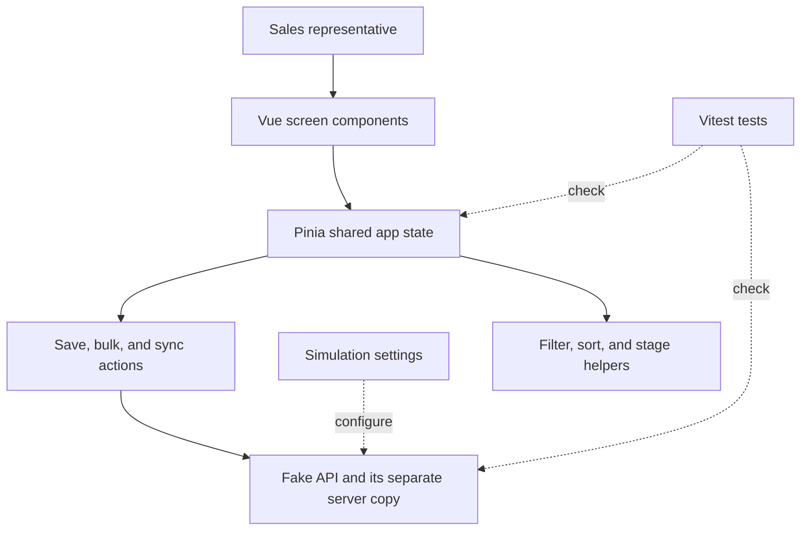

# How the FurniCraft App Is Put Together

This guide follows a user action through the code. It uses plain language first, then names the files and functions so you can find the implementation during an interview. The **fake API** is local code that behaves like a server for this demo; it can load records, save changes, wait, or return an error.

## A simple picture

The screen asks the shared app state to do something. The state asks the fake API to save or load records. The fake API can act like a slow or unreliable service, but it runs locally in this project.



## Technologies used

| Tool | What it does here | Why it is useful |
| --- | --- | --- |
| Vue 3 | Builds the page from smaller screen components | Each part, such as the table or simulation panel, can own its own display and interaction. |
| Vue Composition API | Groups related screen logic inside Vue components | The code can keep the state and functions for one feature together. The project uses Vue’s `<script setup>` style. |
| TypeScript | Describes the shape of an opportunity, stage, and save request | It helps catch mistakes such as using a stage name that the app does not support. It does not check real server data at runtime. |
| Pinia | Holds shared data used by several parts of the page | The table, filters, summary, and bulk toolbar all need the same opportunity state. |
| TanStack Vue Virtual | Renders only the table rows near the scroll position | The browser does not need to create 50,000 rows at once. |
| Vite | Runs the development app and builds it for release | It is the project’s build tool. |
| Vitest and Vue Test Utils | Run code and component tests | They are already integrated with the Vue/Vite project. |
| ESLint and Prettier | Check and format source files | They help keep code style consistent. |

The project has no real API client, database, authentication, charting package, or production backend. `src/services/fakeApi.ts` is a local TypeScript simulation.

## Where the main responsibilities live

| Part of the app | Its job | Main files |
| --- | --- | --- |
| Page shell | Loads the app, applies the theme, and shows notifications | `src/App.vue` |
| Screen pieces | Show the header, summary, filters, table, bulk bar, and simulation controls | `src/components/` |
| Opportunity state | Holds the loaded deals and derives the visible list and metrics | `src/stores/opportunities.ts` |
| Selection state | Remembers checked deal IDs, including deals outside the visible screen | `src/stores/selection.ts` |
| Simulation settings | Holds delay, failure rate, and offline mode | `src/stores/simulation.ts` |
| Individual save and retry | Handles a single opportunity update | `src/stores/opportunities/recordActions.ts` |
| Bulk update and cancel | Sends groups, tracks outcomes, and handles undo | `src/stores/opportunities/bulkActions.ts` |
| Teammate changes and sync | Creates a server-only edit and loads it later | `src/stores/opportunities/syncActions.ts` |
| Fake server | Generates the data, delays requests, fails saves, and checks versions | `src/services/fakeApi.ts` and `opportunityGenerator.ts` |
| Shared data shapes | Defines opportunity fields, stages, and requests | `src/types/opportunity.ts` |
| Small helpers | Filter, sort, choose adjacent stages, and choose the next review row | `src/utils/` |

The opportunity store is the common doorway for the screen. Its work is split into smaller action files so that individual saves, bulk updates, and synchronization do not all live in one huge file.

## What happens when the app starts

1. `src/services/opportunityGenerator.ts` creates 50,000 repeatable sample opportunities. A fixed seed means a reload produces the same sample records.
2. The fake API keeps its own copy of those records in a `Map`—a lookup table indexed by record ID.
3. When the page opens, `loadPipeline()` in `src/App.vue` calls the opportunity store’s `initialize()` action.
4. `initialize()` in `src/stores/opportunities/syncActions.ts` asks `fakeApi.getOpportunities()` for the data, then stores a client-side copy and remembers each record’s version.
5. The table and summary read from the client-side copy. The table only mounts rows near the current scroll position.

The browser therefore has one copy for displaying and editing. The fake API has a separate copy to act as the authority when saves are checked.

## What happens when someone searches or filters

`OpportunityFilterToolbar.vue` updates the filter values in the opportunity store. The store’s `visibleRecords` value calls `filterOpportunities()` and then `sortOpportunities()` from `src/utils/opportunityFilters.ts`.

For example, when a representative types “chairs,” the browser checks the loaded company and product names. If they also choose Aisha Khan and **Stale 30+ days**, those conditions are combined. The screen updates without asking an API for new results.

This is simple for the assignment, but each search may check all 50,000 records. A real product should send search and filters to a backend and receive a smaller page of results.

## What happens when one deal is updated

Imagine a representative clicks the arrow to move Indigo Networks from **New Lead** to **Contacted**.

1. `OpportunityTableRow.vue` emits the requested stage change.
2. `applyStageChange()` in `src/components/OpportunityTable.vue` remembers which deal was next in the review order.
3. The store calls `changeStage()` in `recordActions.ts`. It leaves the displayed stage unchanged and marks the row as saving while it waits for the service.
4. The action calls `fakeApi.updateOpportunity()` with the record ID, the requested stage, and the version it expects to be current.
5. If the fake API accepts the save, it increases the version and returns the saved record. The table changes the stage only now. The row becomes saved, briefly highlights green, and focus moves to the next deal in the old review order.
6. If the save fails, the stage remains at the last confirmed value. The action reads the latest record it can and marks the row as failed. The row offers Retry and the app shows an error toast.
7. If the version is old, the fake API returns the newer record and the row is marked as a conflict instead of silently replacing someone else’s change.

`retry()` in `recordActions.ts` reads the latest server record. If the requested stage has not already been saved, it sends that original stage request again. The prototype does not include a merge screen for comparing different field edits.

## What happens in a bulk update

Suppose a manager selects 1,000 opportunities and moves them to **Contacted**.

1. Checkboxes are stored by opportunity ID in `src/stores/selection.ts`. This matters because most table rows are not mounted while virtual scrolling.
2. **Select all matching** remembers the IDs that match the current filters when clicked. Later scrolling does not change which deals are targeted.
3. `bulkChangeStage()` in `src/stores/opportunities/bulkActions.ts` marks the selected records as saving and shows progress.
4. The action sends up to 500 IDs in one request, waits for the response, then sends the next group. So 1,000 records use two requests.
5. Each record gets its own success or failure result. A successful update stays saved even if another record in the same request fails.
6. The failure panel can retry only failed IDs. The app also offers a version-checked undo for successful records.

### How the changes come back into the table

Before the first request finishes, the selected rows keep their current saved stages and show a **saving** status. The stage changes only as successful results come back from the fake server.

Each group of up to 500 sends three things for every opportunity: its ID, the version currently known to the browser, and the requested stage. For a 1,000-deal update, the app sends the first 500, waits for their results, applies those results to the table, and then sends the next 500.

The fake API checks each opportunity separately. If a save succeeds, it changes its own record and returns that updated record, including the new version and update time. If a save fails or has an older version, it returns an error and, when available, the latest server record. So one response can contain a mix of saved records and failures.

`bulkChangeStage()` in `src/stores/opportunities/bulkActions.ts` matches each result back to its opportunity ID. It updates that row’s version and save status, then calls `installMany()` in `src/stores/opportunities.ts`. `installMany()` replaces the returned records in the browser’s list in one pass, so the table and totals refresh together. Then the app moves on to the next group.

If the whole request fails, for example because the app is offline, there is no normal list of results. The store reads the latest server data it can and marks the affected records as failed. The fake API is only an in-memory simulation; no HTTP request or real database is involved.

The app does not send 1,000 independent requests at once. The batches limit the size of each request and give cancellation points. The fake API still performs individual version and failure checks for each record in a batch.

If the user presses Cancel, the request already sent is allowed to finish. The app then stops before sending the next batch and reloads records that were never sent. Cancel cannot guarantee that the server has undone a request already received.

## What happens when a teammate changes a deal

The simulation panel can change the active deal in the fake server’s copy without changing the table’s copy.

For example, the browser still has **New Lead, version 1**. The teammate simulation changes the server record and increments it to version 2. If the browser then tries to save **Contacted** based on version 1, the fake API rejects it and returns version 2. The row shows **Update conflict**.

The user can click **Sync updates** to load the latest full list and inspect the active deal. If they still want the original stage change, **Retry** submits that intention using the latest version. The app does not sync on its own, so a teammate’s edit does not unexpectedly reorder the table during a review.

This is a one-process simulation. It does not send updates between separate browsers or devices.

## The opportunity data, in everyday terms

`Opportunity` is defined in `src/types/opportunity.ts`.

| Field | What it means |
| --- | --- |
| `id` | A stable identifier for this record; the app uses it for selection and updates. |
| `companyName` | The potential customer, such as Indigo Networks. |
| `opportunityName` | The product being considered, such as Office chairs. |
| `licenceCount` | A legacy field name that currently means furniture units. The screen displays it as “units.” |
| `dealValue` | Estimated value in Indian rupees. |
| `owner` | The sales representative responsible for the deal. |
| `stage` | One of the seven known pipeline stages. |
| `lastActivityAt` | When the customer or sales team last had activity on the opportunity. |
| `createdAt`, `updatedAt` | When the opportunity was created and last updated. |
| `version` | A number increased after each accepted server-side change. It helps detect an older save. |

The row’s save status—saved, saving, error, or conflict—is held separately in the opportunity store rather than written into the opportunity data itself.

## What the fake API does and does not do

`src/services/fakeApi.ts` can:

- Wait for a configurable delay before common requests.
- Fail saves at a configurable random rate or reject requests while offline.
- Check the expected version before saving one record.
- Return a separate result for every record in a bulk request.
- Simulate a teammate changing the server copy.

It does not use HTTP, a database, login, permissions, multiple backend processes, or real-time messaging. It does not persist records after a page reload. `getOpportunity()` is an immediate local read and does not simulate the network delay or offline state; `getOpportunities()` does.

Keeping the fake server separate from Pinia is important. If both names pointed at the same records, a teammate edit would change the screen immediately, and there would be no older browser version to test against.

## Tests and developer commands

Tests live beside the stores, services, utilities, and app. They check important behavior such as version conflicts, filtering, selection, retries, cancellation, and large bulk changes. They do not cover every screen interaction or every possible failure path.

```sh
npm run test   # run the Vitest suite
npm run lint   # check code style and common mistakes
npm run build  # type-check and build the app
```

The tests use Vitest and Vue Test Utils. The API accepts injected randomness and delays in tests, so failure scenarios can be made predictable rather than waiting for chance.
