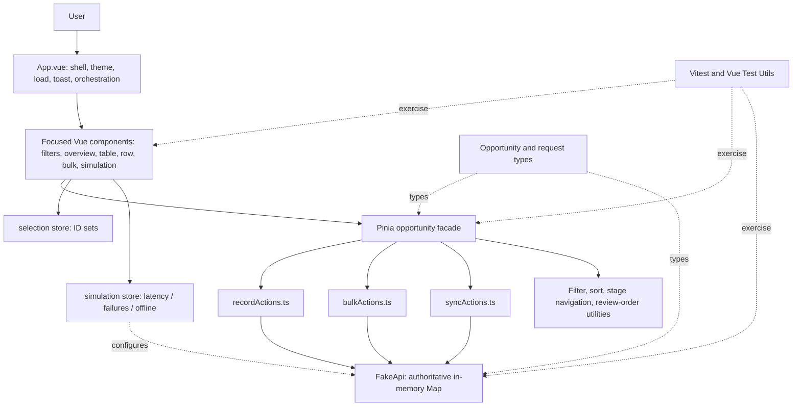

# Engineering architecture

## Technology stack

| Technology | Role here | Why it fits this assignment | Alternative |
|---|---|---|---|
| Vue 3.5 | UI components and reactive rendering | Existing app is a small, component-based Vue workspace; `<script setup>` keeps component logic readable | React, Svelte, or Vue Options API |
| TypeScript 5.9 | Stage, record, filters, and request types | Catches invalid stage/request shapes while refactoring | JavaScript plus runtime validation |
| Pinia 3 | Shared client state | Table, filters, metrics, simulation, and bulk controls share state | Component state or another state library |
| `@tanstack/vue-virtual` | Virtual row window | Prevents mounting all 50k rows | Pagination or custom virtualizer |
| Vite 7 + Vue plugin | Dev server and production bundling | Lightweight Vue toolchain | Vue CLI or another bundler |
| Vitest + Vue Test Utils + jsdom | Unit/component tests | Vue-aware tests with fast Vite config | Jest/browser E2E framework |
| ESLint, Prettier | Static checks and formatting | Consistent style and basic correctness | Other lint/format tools |

`package.json` has no HTTP client, database, charting library, or production backend dependency. The fake API is local TypeScript.

## Architecture diagram

## Project layout

- `src/App.vue`: page shell, theme persistence, startup load, global keyboard shortcuts, toast and bulk orchestration.
- `src/components/`: focused presentation and interaction units. `OpportunityTable.vue` owns virtualization, sort headers, active-row navigation, explicit sync, keyboard navigation, and save-success focus flow; `OpportunityTableRow.vue` owns row controls/status display.
- `src/stores/opportunities.ts`: Pinia state and derived table/summary values plus action facade composition.
- `src/stores/opportunities/recordActions.ts`: individual optimistic write/retry and same-record request sequencing.
- `src/stores/opportunities/bulkActions.ts`: batched writes, progress, cancellation, and version-checked undo.
- `src/stores/opportunities/syncActions.ts`: initialization, full snapshot sync, teammate server edit, and active row state.
- `src/stores/selection.ts`: selected-ID representation, all-matching snapshot and exclusions.
- `src/stores/simulation.ts`: user controls and fake API configuration.
- `src/services/opportunityGenerator.ts`: deterministic seeded furniture opportunity dataset.
- `src/services/fakeApi.ts`: authoritative server simulation.
- `src/utils/`: pure filtering/sorting, stage navigation, and next-review choice.
- `src/types/opportunity.ts`: shared stage, opportunity, filter, request, save-state, and config types.
- `src/*.spec.ts` and nested `*.spec.ts`: unit and component tests.

## Data flow

### Initial dataset and loading

1. `fakeApi.ts` constructs a singleton `FakeApi`; absent fixtures, its constructor calls `generateOpportunities()` (default 50,000, deterministic seed 42).
2. `App.vue` calls `loadPipeline()` on mount. It invokes store `initialize()`.
3. `syncActions.initialize()` gets the full cloned snapshot through `fakeApi.getOpportunities()`, populates `records`, `recordById`, and `serverVersions`, then sets initialized/loading flags.
4. The table derives `visibleRecords`; `OpportunityTable.vue` gives that list to TanStack Virtual. Metrics derive from loaded records.
5. On load error, `App.vue` shows a load error with a retry action. There is no random failure on GET, though simulated offline/delay affects it.

### Search, filters, sorting

`OpportunityFilterToolbar.vue` writes values into the opportunity store's `filters`. Search is immediate. `visibleRecords` in `opportunities.ts` runs `filterOpportunities(records, filters)` then `sortOpportunities(...)`. Both operate in the browser on the full loaded array. Stage summary clicks call `setStageFilter`; sort headers call `toggleSort`.

### Individual stage update

1. Row dropdown/arrows emit a stage intent; the table marks the row active and calls `changeStage(id, stage)`.
2. `recordActions.changeStage()` saves the intended stage in `retryStages`, increments local `revisions[id]`, installs an optimistic record, sets `saving`, and clears prior error.
3. Same-ID writes are chained through `queues`. When a queued write runs, it reads the latest fake server version with `getOpportunity`, then calls `updateOpportunity` using cached `serverVersions[id]` as `expectedVersion` (or the fetched version if no cache exists).
4. On success, it updates server version and only installs the response if that local revision is still latest. The row becomes saved and retry intent clears.
5. On ordinary failure, it fetches the latest server copy and restores it where possible (falls back to the captured base if reconciliation fails). On version conflict, the API includes latest data and the row becomes conflict for review.
6. Retry (`retry(id)`) reads server data; if it already contains the requested stage, it marks saved, otherwise installs the latest record and replays the user's intended stage.
7. `OpportunityTable.applyStageChange()` highlights the row and advances keyboard focus to the next opportunity from the pre-update visible order after a successful update.

### Bulk stage update

1. `BulkActionBar.vue` collects a stage and calls App orchestration; selected IDs come from the selection store.
2. `bulkChangeStage()` snapshots current records/stages/versions, marks rows optimistically saving, and installs the set of optimistic rows with one bounded array pass.
3. `bulkActions.ts` slices selected records into sequential batches of at most 500 and dispatches `fakeApi.bulkUpdateOpportunities()` once per batch. A batch incurs one configured network delay, then per-record version/failure outcomes.
4. Successes receive authoritative rows and versions. Failures receive latest record when supplied/readable and are marked error/conflict. Progress is reported in batch units. Successful rows are not sent by `retryFailedOnly`.
5. Cancellation stops dispatch after current batch settles, then reads and installs untouched rows in chunks, yielding between chunks. This is not transport abort or server rollback.
6. App displays a persistent partial-failure panel and offers failed-only retry plus best-effort undo. The undo is a compensating write guarded by post-bulk version.

### Teammate edit and sync

`SimulationPanel.simulateActiveDealEdit()` picks the active record (or a random record fallback) and `syncActions.simulateTeammate()` asks the fake server to change it. The local record stays unchanged; pending ID/generation state indicates unseen changes. The table's manual Sync updates action calls `syncLatest()`, which fetches a complete 50k snapshot, retains local records currently marked saving, rebuilds maps, and clears the pending marker only if no newer teammate simulation generation arrived during fetch. Go to active row scrolls virtualized table to active record.

### Concurrency conflict example

The server holds version 1. Browser A submits Contacted with expectedVersion 1; it succeeds and the server becomes version 2. Browser B submits Lost with expectedVersion 1; the server returns a conflict plus version 2, rather than overwriting the newer record. In this demo, both “browsers” are represented by separate local/server states inside one process; the fake API is not shared across actual devices.

## Pinia store responsibilities

| Store | State and actions | Consumers | Why separate |
|---|---|---|---|
| `useOpportunityStore` (`opportunities.ts`) | Records, indexes, filters/sort, derived metrics, loading, active row, sync pending, save/errors, bulk progress/undo; exposes composed actions | App, table, rows, toolbar, overview, simulation, bulk bar | Domain state and write workflows have one owner; action files keep the facade understandable |
| `useSelectionStore` (`selection.ts`) | Explicit `selectedIds`; optional `allMatchingIds` and `excludedIds`; selection count/toggle/list/clear | Table, bulk bar, App | Selection is transient UI intent, not opportunity data; works with virtual rows |
| `useSimulationStore` (`simulation.ts`) | Delay bounds, failure rate, offline, teammate updates enabled, dataset size; watches config and calls `fakeApi.configure` | Simulation panel and fake API configuration | Demo controls are isolated from business records |

The opportunities store also maintains non-reactive Maps for record lookup, server versions, local revisions, per-ID queues, and retry stage intents. Derived `visibleRecords`, `stageCounts`, `totalValue`, `attentionCount`, `filteredIds`, and pending-sync values are computed.

## Data model

`Opportunity` in `src/types/opportunity.ts` contains:

| Field | Meaning |
|---|---|
| `id` | Stable generated string identity; used for virtualizer keys, maps, selection, and server lookup |
| `companyName` | Potential business customer (not FurniCraft) |
| `opportunityName` | Product label plus quantity context, displayed as furniture units |
| `dealValue` | Numeric INR amount |
| `licenceCount` | Legacy property name retained from assignment code; represents furniture unit quantity in the UI |
| `owner` | Sales representative assigned to the opportunity |
| `stage` | Union of seven `DEAL_STAGES` |
| `lastActivityAt`, `createdAt`, `updatedAt` | ISO timestamps for recency, creation, and save sorting/display |
| `version` | Server incremented revision for optimistic concurrency control |

`UpdateRequest` identifies a record, expected version, and allowed partial changes (`stage`, `owner`, `dealValue`). `SaveState` is `saved | saving | error | conflict`. Save state and errors are held separately in Pinia maps, not persisted on Opportunity. Operation IDs are not used; local per-record integer revisions are used for response freshness.

## Fake API contract and boundaries

`FakeApi` owns a private `Map<string, Opportunity>` and clones at API boundaries. `configure()` sets latency, save failure probability, and offline state. `simulate()` delays then rejects offline calls. `getOpportunities()` returns all records; `getOpportunity()` returns one without simulated delay/offline behavior. `updateOpportunity()` delays, may randomly fail, compares `expectedVersion`, increments version and `updatedAt`. Bulk update delays once per batch and returns an independent success/error for each record. Teammate edits update only server state.

Client and fake server must remain separate for the stale-client conflict scenario to be meaningful. If Pinia were the server too, a simulated teammate would just overwrite client state directly and there would be no old client version to reject. Cloning also prevents accidental reference mutation.

The fake API does **not** provide persistence, HTTP transport, schema validation, authentication, permissions, multi-process state, actual multi-client broadcast, database transactions, idempotency keys, server cancellation, rate limiting, or request telemetry. `getOpportunities()` and `syncLatest()` are full-snapshot operations and are not a production pagination strategy.

## Tests and build

`npm run build` runs `vue-tsc -b` followed by Vite production build. `npm test` runs Vitest. `npm run lint` runs ESLint. Tests exercise pure utilities, generator/API/store behavior, and a small App integration surface. They do not yet cover every interaction/failure matrix: see `IMPLEMENTATION_MAP.md` and `FAILURE_SCENARIOS.md`.
